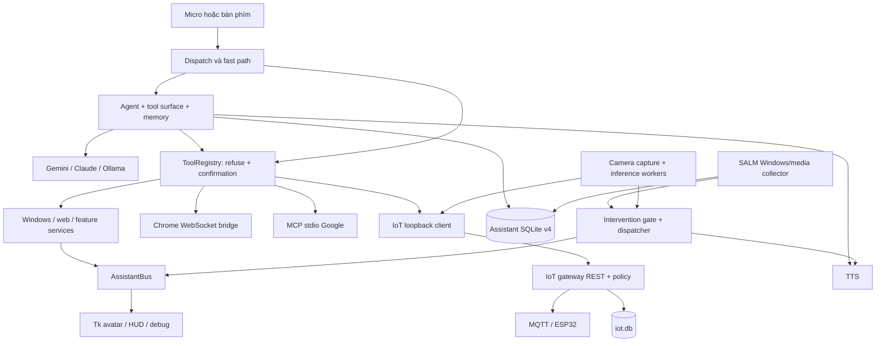

# BÁO CÁO ĐÁNH GIÁ KIẾN TRÚC & TÍNH NĂNG TOÀN DIỆN

> **Audit gốc:** 29/09/2026, trên working tree lúc đó. **Cập nhật trạng thái:** 26/10/2026, đối chiếu
> lại từng phát hiện với code tại commit `3c508f2`. Phân tích gốc được giữ để thấy vì sao một
> mục bị đánh giá như vậy; mỗi mục có thêm dòng **Trạng thái 26/10** ghi rõ đã sửa gì, bằng chứng
> nằm ở đâu và phần nào còn mở. Số dòng `file:line` trong phần phân tích gốc là theo snapshot
> 29/09 và có thể đã lệch.

## 0. Trạng thái hiện tại (26/10/2026)

**Regression gate:** 1.943 test passed, 6 xfailed, 0 failed. Sáu xfail là test `strict` mô tả hai
lỗi hợp đồng kết quả (bridge Chrome và IoT trả lỗi nhưng bị coi là thành công) đang chờ sửa; chúng
sẽ đỏ khi lỗi được sửa mà chưa gỡ đánh dấu. GitHub Actions chạy toàn bộ suite trên Windows mỗi lần
push; bản clone sạch tự bỏ qua 76 test cần `chrome_extension/` (thư mục này không nằm trong repo).

| Mã | Phát hiện | Mức gốc | Trạng thái 26/10 | Bằng chứng / phần còn lại |
| :--- | :--- | :--- | :--- | :--- |
| F01 | Xóa trí nhớ không bền khi SQLite lỗi | High | **Đã sửa** | `0721ad4`: xóa ở kho bền trước, lỗi thì báo chưa xóa và giữ nguyên; test trong `test_event_memory.py`, `test_local_database.py` |
| F02 | Fallback SALM daily ghi đè tổng | High | **Còn mở** | Nhánh fallback vẫn chỉ ghi số liệu phiên hiện tại |
| F03 | Scheduler hủy việc khi callback lỗi | High | **Sửa phần lớn** | `0721ad4`: thử lại lời nhắc tối đa 3 lần, không thử lại lệnh `do`, chuẩn hóa giờ aware/naive; còn thiếu trạng thái `delivered/suppressed` |
| F04 | IoT timer kết thúc trước ACK | High | **Còn mở** | `tick()` vẫn xóa `run_until` ngay sau khi publish |
| F05 | "Lịch hôm nay" sai khoảng thời gian | High | **Sửa phần lớn** | `0721ad4`: `[0h hôm nay, 0h ngày mai)` theo giờ máy; test `test_calendar_today.py`; còn `maxResults=20`, chưa phân trang |
| F06 | Lỗi bị diễn giải là thành công | High | **Sửa phần lớn** | `0721ad4`: Ollama ném lỗi khi HTTP lỗi hoặc phản hồi sai dạng; mở/đóng ứng dụng ném lỗi khi thất bại; `fetch_url_text`, `wikipedia_summary` vẫn trả câu lỗi như kết quả thường |
| F07 | Store báo "đã lưu" dù ghi đĩa lỗi | High | **Đã sửa** | `0721ad4`: tasks, routines, contacts, scheduler ghi đĩa trước rồi mới đổi state; lỗi nổi lên cho tool |
| F08 | Tích hợp IoT/camera làm đỏ regression gate | High | **Sửa một phần** | Sáu gate đã xanh; `CameraService` vẫn chưa có contract test riêng |
| F09 | Browser bridge không fail closed | Med | **Sửa một phần** | `a292fe2`: token rỗng thì từ chối kết nối, so token bằng `hmac.compare_digest`; `start()` vẫn trả True khi bind lỗi, origin chỉ kiểm tiền tố |
| F10 | Truy xuất trí nhớ không xử lý mâu thuẫn | High | **Còn mở** | Chạy lại evaluator: số liệu y nguyên, vẫn chọn cả 4/4 fact cũ bị cấm |
| Logging | Log chứa nội dung tham số/lời nói | Med | **Sửa phần lớn** | `a292fe2`: `utils/privacy.py` lọc log theo allowlist metadata; test `test_r0_data_boundaries.py` |
| R09 | Khả năng tái lập, tài liệu | Med | **Sửa một phần** | `3c508f2`: CI Windows, sửa encoding file requirements, thêm `fastmcp`, cập nhật số test README; launcher vẫn hardcode Python, chưa có lockfile |
| V01–V06 | Cơ hội mở rộng | — | **Chưa làm** | Không đổi so với audit |
| R01–R08 | Hiệu năng và refactor | Med/High | **Còn mở** | R05 nặng hơn: `app.py` 1.633 dòng, camera service 1.234 dòng |

**Ưu tiên kế tiếp:** F02, F04 (toàn vẹn dữ liệu và trạng thái thiết bị), sáu xfail của hợp đồng kết
quả, rồi F10 và R04.

## 1. Bản đồ tổng quan hệ thống (System Landscape)

- **Tech Stack cốt lõi:** Python; Tkinter/Pillow cho desktop UI; PyAudio, SpeechRecognition, faster-whisper/openai-whisper cho STT; gTTS, pyttsx3, Piper và VieNeu cho TTS; Gemini REST, Anthropic SDK và Ollama REST cho LLM. SQLite lưu dữ liệu assistant và IoT; JSON/JSONL còn phục vụ cấu hình, các store nhỏ và fallback. Windows API/COM, psutil, pycaw và screen-brightness-control điều khiển máy. Chrome MV3 JavaScript ↔ WebSocket; MCP stdio ↔ Google Calendar/Gmail/Contacts qua OAuth; Paho MQTT ↔ ESP32. Camera dùng OpenCV và các worker face, emotion, gesture, proximity/head motion; MediaPipe và ONNX Runtime có manifest tùy chọn riêng. OpenTelemetry SDK (tùy chọn) đo độ trễ cục bộ, không có exporter ra ngoài.
- **Mô hình kiến trúc phát hiện:** Modular desktop monolith theo feature, ghép bằng composition root `src/app.py`; luồng nghiệp vụ chính đồng bộ, chạy trên worker thread; Tk chạy main thread và nhận sự kiện qua queue. Có adapter cho LLM, browser và MCP nhưng chưa phải Clean/Hexagonal đầy đủ. IoT gateway là process riêng, có REST loopback và SQLite riêng; đây không phải hệ thống microservices tổng quát.
- **Đánh giá sức khỏe kỹ thuật (cập nhật 26/10):** Nền tảng tốt ở registry tập trung, cổng xác nhận bằng code, giới hạn nội dung ngoài, SQLite migration và nhiều test logic thuần. So với 29/09, regression gate đã xanh và có CI; nhóm lỗi "báo thành công sai" (F06, F07) và xóa trí nhớ (F01) đã được sửa. Rủi ro lớn còn lại là phục hồi dữ liệu SALM (F02), vòng đời lệnh IoT (F04), mâu thuẫn trí nhớ (F10) và I/O chặn trên Tk (R04). Composition root và camera service tiếp tục phình to, nên tách lifecycle (R05/R06) ngày càng đáng làm.

### Phạm vi, phương pháp và giới hạn bằng chứng

Audit gốc ngày **29/09/2026**, trên **working tree lúc đó**, bao gồm file đã sửa và file chưa được Git theo dõi. Không sửa mã ứng dụng trong nhiệm vụ audit.

Đã quét thư mục gốc, dependency manifests, entry points và danh mục feature; phân tích AST của **203 file Python trong `src/` (32.127 dòng)** và server Google **361 dòng**; kiểm tra inventory **97 file Python trong `tests/` (18.400 dòng)**. Đọc sâu các đường agent/tool gate, persistence/profile/SALM, scheduler, IoT, browser/MCP, UI callback, camera pipeline và research; đối chiếu các module còn lại qua khai báo, call site, test và tài liệu. Các số dòng là số dòng vật lý, gồm comment và dòng trống; kích thước lớn là tín hiệu cần xem xét trách nhiệm, không tự nó chứng minh lỗi.

**Cập nhật 26/10** đọc lại code hiện tại của từng vị trí được nêu, đọc diff các commit sau audit (`2b27fe5`, `a85dbc0`, `a292fe2`, `0721ad4`, `3c508f2`), chạy lại toàn bộ test suite và evaluator truy xuất trí nhớ. Không chạy lại các probe tái hiện ban đầu; mục nào ghi "đã sửa" dựa vào code và test mới đi kèm bản sửa.

**Cách phân biệt bằng chứng:** "Tái hiện" nghĩa là đã gọi code bằng dữ liệu giả/mock, không gọi dịch vụ thật. "Quan sát code" nghĩa là kết luận về nhánh thực thi hoặc cấu trúc hiện có, chưa đo ảnh hưởng trên thiết bị. "Đề xuất" là thiết kế tương lai, không được trình bày như tính năng đã hoạt động. Không thử micro, webcam, ESP32, MQTT broker, Gmail, gửi mail, đóng ứng dụng thật hoặc API LLM thật. Không benchmark tải production và không đọc nội dung `.env`, OAuth token, database cá nhân hay embedding của người dùng.

### Manifest, điểm vào và cấu hình

| Thành phần | Vị trí | Vai trò và trạng thái quan sát |
| :--- | :--- | :--- |
| Dependency chính | `src/requirements.txt` | Dependency chủ yếu dùng version floor `>=`; chưa có lockfile |
| Dependency tùy chọn | `src/requirements-gesture.txt`, `src/requirements-emotion.txt`, `src/requirements-telemetry.txt` | Pin MediaPipe/ONNX Runtime; cài riêng với runtime core |
| Development / MCP | `requirements-dev.txt`, `mcp_servers/requirements.txt`, `pytest.ini` | `requirements-dev.txt` gom runtime + telemetry + MCP + pytest (từ 26/10); manifest MCP chưa pin phiên bản |
| CI | `.github/workflows/tests.yml` | pytest trên `windows-latest`, Python 3.12, mỗi push/PR (từ 26/10) |
| Desktop | `launch_assistant.vbs`, `src/app.py` | Launcher chọn đường Python tuyệt đối theo máy; `main()` ghép toàn hệ thống |
| Entry cũ | `src/legacy/{main,agent_cli,avatar_app}.py` | Còn tồn tại; tài liệu xác định không được bảo trì đầy đủ như `app.py` |
| Feature catalog | `src/features/catalog.py` | 13 khai báo: system, web, weather, schedule, browser, screen, profile, task, pim, place, activity, iot, camera |
| Registry/router | `src/features/registry.py`, `src/agent/tools.py`, `src/agent/router.py` | Gắn tool, áp cổng thực thi, phân loại yêu cầu; router này là LLM router, không phải HTTP router |
| Cấu hình | `src/utils/config.py`, `src/voice/config.py`, `src/features/iot/settings.py` | Nạp `src/.env`; env thật ưu tiên; chuẩn hóa đường dẫn theo gốc repo |
| Google | `mcp_servers/google_personal.py` | MCP server; Calendar, Gmail, Contacts; OAuth do process server giữ |
| Chrome | `chrome_extension/manifest.json`, `background.js`, `src/services/browser_bridge.py` | MV3 service worker ↔ WebSocket Python; extension chỉ có ở máy phát triển, bị Git ignore |
| IoT | `src/features/iot/gateway.py`, `packaging/iot/*` | REST `/v1/*`, MQTT ingestion, policy tick, timer; gateway tồn tại độc lập với desktop |
| Models/schemas | `src/persistence/database.py`, `src/features/salm/models.py`, `src/features/iot/storage.py` | Assistant schema v4, SALM dataclasses, IoT schema riêng |

### Luồng dữ liệu và ranh giới



### Bản đồ lưu trữ

| Kho | Dữ liệu | Cơ chế hiện có / giới hạn |
| :--- | :--- | :--- |
| Assistant SQLite | `salm_events`, `salm_daily`, `interaction_outcomes`, `memory_facts`, `memory_evidence`, `user_preferences`, `habit_observations`, `salm_app_preferences` | WAL, transaction `BEGIN IMMEDIATE`, FK, busy timeout, migration v1–v4; mỗi operation đóng connection |
| IoT SQLite | measurements, hourly, device_state, alerts, commands, automation_state | Shared connection được RLock bảo vệ; raw 7 ngày, hourly/commands 14 ngày, alerts 7 ngày; prune theo giờ |
| Store JSON | reminders, tasks, routines, contacts, location, persona và preference phụ | Atomic replace; từ 26/10 các store tasks/routines/contacts/reminders ghi đĩa trước rồi mới đổi state RAM. Atomic file replacement không bảo đảm transaction nhiều store/process |
| Compatibility/fallback | SALM JSON/JSONL, profile/habits JSON, outcome JSONL | Import theo fingerprint/idempotency; lỗi hợp nhất SALM daily (F02) còn mở |
| Model/blob | Voice models/audio, camera models/template, PNG, captures | Tách khỏi SQLite; face template dùng DPAPI CurrentUser và ACL, không plaintext fallback |

Catalog đầy đủ với dependency mock (29/09): **56 tool, 13 feature, 22.345 ký tự specs / budget 22.650**. Camera có **0 tool**; các tool MCP sinh động chưa tính vào số 56. Đây là phép đo catalog tối đa bằng helper test, không phải cam kết mọi cấu hình runtime đều nạp tất cả feature.

## 2. Bảng ma trận phân loại chi tiết

Ưu tiên: **High/P1** = sửa trước khi mở rộng/release phần liên quan; **Med/P2** = sprint bảo trì kế tiếp; **Low/P3** = khi có nhu cầu. Effort tương đối: **S ≈ 1–3 SP**, **M ≈ 5–8 SP**, **L ≈ 13+ SP**, chưa phải cam kết thời gian. Module có nhiều vấn đề được tách nhiều dòng; phân loại không có nghĩa toàn bộ module đều dở dang.

| Tên tính năng / Module | Phân loại | Hiện trạng gốc & Điểm nghẽn | Đề xuất hành động kỹ thuật | Ưu tiên | Effort | Trạng thái 26/10 |
| :--- | :--- | :--- | :--- | :--- | :--- | :--- |
| Profile + SQLite fallback (F01) | Nửa vời | Xóa lỗi nhưng báo đã quên; dữ liệu trở lại khi restart | Durable mutation journal/tombstone, báo trạng thái pending, reconcile trước projection | High/P1 | M/8 | Đã sửa |
| SALM daily fallback (F02) | Nửa vời | Reimport file fallback thay thế tổng đã có | Session projection có khóa duy nhất, rebuild aggregate; kiểm tra recovery | High/P1 | M/8 | Còn mở |
| Schedule (F03) | Nửa vời | Callback lỗi vẫn xóa task; datetime aware/naive không tương thích | State machine job, retry có chính sách, UTC/timezone rõ ràng | High/P1 | M/8 | Sửa phần lớn |
| IoT off timer (F04) | Nửa vời | Deadline bị xóa khi publish mới được chấp nhận, trước ACK | Giữ job đến terminal result; thể hiện unknown, giới hạn retry theo protocol | High/P1 | M/8 | Còn mở |
| PIM Calendar (F05) | Nửa vời | "Hôm nay" chỉ từ now đến cuối ngày UTC | Day range theo timezone người dùng/lịch, phân biệt today/upcoming | High/P1 | S/3 | Sửa phần lớn |
| LLM/Windows/web result (F06) | Nửa vời | Ollama HTTP 500 → turn rỗng; taskkill lỗi → "Đã đóng" | Typed error/result ở adapter, kiểm HTTP/exit code, kiểm outcome/habit | High/P1 | M/5 | Sửa phần lớn |
| Task/routine/contact JSON (F07) | Nửa vời | `_save` nuốt OSError; caller vẫn báo đã lưu | Commit thành công rồi publish state; lỗi durability phải nổi lên | High/P1 | M/5 | Đã sửa |
| Feature/tool integration (F08) | Nửa vời | 6 regression gates fail sau tích hợp IoT/camera | Đồng bộ trust, eval, core policy, router cases và snapshot đã review | High/P1 | M/5 | Đã sửa (gate xanh) |
| Camera (F08, R05) | Nửa vời | Không có test tham chiếu implementation camera trong suite | Test generation/freshness/pause/conflict/budget với fake capture và clock | High/P1 | L/13 | Còn mở |
| Browser bridge (F09) | Nửa vời | Token mặc định rỗng bỏ kiểm tra; start trả True kể cả bind lỗi | Fail closed với token, báo startup state thật, pairing extension | Med/P2 | M/5 | Sửa một phần |
| Memory retrieval (F10) | Nửa vời | 4/4 forbidden stale facts lọt benchmark contradiction | Slot/version/supersedes, resolver trước lexical ranking | High/P1 | L/13 | Còn mở |
| Task due (V01) | Tiềm năng | Có trường due/API nhập, list và morning brief không dùng hạn | Date contract, UI deadline, overdue query; nhắc opt-in | Med/P2 | M/5 | Chưa làm |
| Memory provenance/consent (V02) | Tiềm năng | Có sensitivity/consent/evidence/status, chưa dùng hết ở projection/UI | Memory inspector và projection theo scope, correction lịch sử | Med/P2 | L/13 | Chưa làm |
| Activity Insights/circadian (V03) | Tiềm năng | Daily chứa passive/audio và 48 bucket; UI analytics mới chủ yếu interactive | Aggregate views, coverage, baseline provider opt-in | Med/P2 | M/8 | Chưa làm |
| SALM late-night baseline (V03) | Tiềm năng | `NoRoutineBaselineProvider` trả baseline rỗng | Observed baseline provider tương thích snapshot; đủ dữ liệu mới hoạt động | Low/P3 | L/13 | Chưa làm |
| Notifications/proactive (V04) | Tiềm năng | Dispatcher và notify callback đã có; trình bày chủ yếu giọng/UI | NotificationSink cho desktop và kênh bên ngoài được cấu hình rõ | Low/P3 | M/8 | Chưa làm |
| Places/research providers (V05) | Tiềm năng | Maps/OSM và injected HTTP/browser seam đã có | Adapter rõ contract, typed evidence, source health; giữ ranking riêng từng loại nguồn | Med/P2 | M/8 | Chưa làm |
| Camera role/capabilities; IoT v2 (V06) | Tiềm năng | Capability/topic mapping có sẵn; correlated ACK phụ thuộc firmware | Protocol adapter/device registry; hardware validation trước auto-on | Med/P2 | L/13 | Chưa làm |
| PIM Gmail (R01) | Cần tối ưu | 1 list + N metadata GET tuần tự, N tối đa 25 | Batch hoặc bounded concurrency; metadata TTL ngắn, pagination | Med/P2 | M/5 | Còn mở |
| IoT status/policy (R02) | Cần tối ưu | Snapshot 1+2D SELECT; devices map đọc lại trong loop | Một snapshot DB và unique-room bulk latest; retention indexes theo EXPLAIN | Med/P2 | M/5 | Còn mở |
| Outcomes/persistence (R03) | Cần tối ưu | Read toàn bảng; không có outcome retention SQLite | Range/limit/keyset query, purge policy, job backup/restore | Med/P2 | M/8 | Còn mở |
| Tk HUD/mail/draft (R04) | Cần tối ưu | UI callback chờ lock/network/TTS đồng bộ | Application command worker, completion event, pending token | High/P1 | M/8 | Còn mở |
| app/camera/agent (R05) | Cần tối ưu | 1.475/1.093/811 dòng; main() 619 dòng | Tách lifecycle, command handler, camera supervisor/workers | Med/P2 | L/13 | Còn mở, tăng lên 1.633/1.234/830 dòng |
| Lifecycle/queues (R06) | Cần tối ưu | Functional queue không bound; shutdown không join agent trước flush | Bounded/coalesced queue; stop intake → join → flush → close | Med/P2 | M/8 | Còn mở |
| Research I/O và cache (R07) | Cần tối ưu | Fetch có deadline nhưng worker tiếp tục; resolve tùy chọn tuần tự | Shared bounded executor, per-request deadline/size, selective cache | Med/P2 | M/8 | Còn mở (file không đổi) |
| SALM retention/flush (R08) | Cần tối ưu | Purge chỉ khi start; engine giữ mọi ngày phiên và ghi lại mỗi phút | Periodic purge, dirty-day flush, prune RAM cùng policy | Med/P2 | M/5 | Còn mở |
| Voice STT/TTS | Cần tối ưu | STT đã có timeout; TTS synth/prefetch dùng worker và file tạm | Giữ fallback; bổ sung deadline gTTS và shutdown ownership trong R06 | Med/P2 | M/5 | Một phần: TTS cục bộ lỗi không còn gửi text lên cloud và dọn file wav tạm (`a292fe2`) |
| Security/logging | Cần tối ưu | Debug che key, nhưng log tool và stdout vẫn chứa nội dung tham số/lời nói | Logging theo allowlist metadata, opt-in content, retention độc lập | Med/P2 | M/5 | Sửa phần lớn |
| Packaging/docs/legacy (R09) | Cần tối ưu | Python path theo máy, dependency không khóa, extension/spec chính bị ignore, tài liệu cũ | Reproducible bootstrap, version source/spec, CI, archive legacy | Med/P2 | M/8 | Sửa một phần |

## 3. Phân tích chi tiết theo chuyên đề

### 3.1. Nhóm tính năng nửa vời & Rủi ro tiềm ẩn (Must-Fix)

Các mẫu code dưới đây minh họa hướng sửa, **không phải bản vá đã áp dụng**. Không có phát hiện nào được gắn Critical chỉ từ giả định về tấn công/thiết bị; High ở đây dựa vào lỗi tái hiện hoặc cổng kiểm tra đang thiếu.

#### F01 — Xóa trí nhớ không bền vững khi SQLite lỗi — High

**Trạng thái 26/10: Đã sửa** (`0721ad4`). `UserProfile.forget()` xóa ở kho bền (SQLite, hoặc file JSON khi không có DB) **trước**; chỉ khi thành công mới bỏ khỏi RAM và báo "Đã quên". Lỗi lưu trữ thì trả lời "chưa xóa được, thông tin vẫn còn" và không chuyển sang file fallback, nên khởi động lại không còn hồi sinh fact. Cách sửa chọn "fail closed" thay cho journal/tombstone đề xuất bên dưới: đơn giản hơn và đủ cho một tiến trình. Còn lại: `remember()` vẫn ghi nhiều trường bằng nhiều transaction riêng.

**Vấn đề gốc:** `forget()` pop khỏi `self.data`, gọi DB delete; ngoại lệ dẫn tới `_database_failed()`, bỏ DB và ghi snapshot JSON đã xóa, rồi vẫn trả "Đã quên". Khi khởi động lại, importer JSON không xóa row còn trong DB và `load_user_profile()` đưa row đó trở lại. Probe với lỗi tiêm vào `delete_profile_item` đã tái hiện: note báo đã quên xuất hiện lại sau restart.

**Đề xuất gốc (vẫn hợp lệ nếu cần xóa khi DB tạm lỗi):** journal mutation với operation ID; delete là tombstone được importer/reconciler tôn trọng; khi chưa hòa DB thì phản hồi "đang chờ đồng bộ xóa".

#### F02 — Fallback SALM daily ghi đè tổng các phiên trước — High

**Trạng thái 26/10: Còn mở.** `SalmStorage.write_daily()` vẫn ghi `payload` của phiên hiện tại vào `daily-<ngày>.json` khi SQLite lỗi; commit `a292fe2` chỉ thêm cờ `recording`, không đổi logic hợp nhất.

**Vị trí:** `src/features/salm/storage.py` (`write_daily`); `src/persistence/database.py` (`_import_salm_daily`).

Nhánh DB cộng `_daily_base` với metrics phiên hiện tại. Khi ghi DB lỗi, file fallback lại chỉ ghi `payload` của phiên hiện tại. Importer sau đó UPSERT **thay thế** `metrics_json` bằng file này.

**Tái hiện (29/09):** SQLite đã có `work_engagement=100`; phiên mới thêm 5; tiêm lỗi `replace_salm_daily`; tạo `SalmStorage` mới để import fallback. Kết quả DB **5**, trong khi tổng cần giữ **105**.

**Đề xuất:** lưu contribution theo `(session_id, day)` và upsert contribution; aggregate theo ngày được dựng lại từ contribution. Nếu tạm sửa snapshot, phải có revision/khóa phiên và quy tắc conflict; chỉ cộng file vào DB sẽ double count khi retry.

```python
with repository.transaction():
    repository.upsert_session_daily(session_id, day, cumulative_session_metrics)
    repository.rebuild_daily(day)  # SUM trên các session contributions duy nhất
```

**Nghiệm thu:** nhiều restart, fallback file nhập lặp, DB hồi phục giữa phiên, hai contribution cùng ngày và xóa lịch sử phải giữ đúng tổng/đúng retention.

#### F03 — Scheduler hủy công việc dù callback thất bại — High

**Trạng thái 26/10: Sửa phần lớn** (`0721ad4`, test `tests/test_scheduler.py`).
- Lời nhắc (`kind="remind"`) lỗi khi phát được hẹn lại sau 1 phút, tối đa 3 lần. Lệnh `kind="do"` không tự chạy lại vì có thể đã gây side effect.
- Mọi mốc giờ được quy về giờ địa phương naive (`_local_naive`), nên trộn giờ aware và naive không còn ném `TypeError`. Khi nạp file, mục có giờ hỏng bị bỏ qua thay vì làm hỏng cả lượt quét.
- Mọi thay đổi ghi đĩa trước rồi mới đổi state (xem F07).

Còn lại: chưa có trạng thái bền `delivered/suppressed/failed`. `_run_scheduled()` trong `app.py` vẫn không báo cho scheduler biết khi dispatcher chặn lời nhắc (ví dụ đang DND). Scheduler vẫn chạy trong tiến trình desktop, nên tắt app thì không nhắc.

**Vấn đề gốc:** `_fire_due()` catch lỗi `notify` rồi luôn `cancel(task['id'])`, nên callback lỗi làm mất việc (probe: remaining=0). `add()` nhận datetime aware nhưng `_fire_due()` so với `datetime.now()` naive, dẫn tới `TypeError` cho cả batch.

**Đề xuất cho phần còn lại:** persist states `scheduled/running/retry/delivered/suppressed/failed`; `notifier.deliver()` trả kết quả để scheduler ghi đúng trạng thái; muốn nhắc khi app đóng thì tách worker/service có ownership rõ ràng.

#### F04 — IoT timer hoàn tất trước xác nhận thiết bị — High

**Trạng thái 26/10: Còn mở.** `IoTCore.tick()` vẫn xóa `run_until`, `timer_source` và đặt cooldown ngay sau khi `_send_power()` publish thành công, trước khi có ACK.

**Vị trí:** `src/features/iot/core.py` (`tick`, `_send_power`); `src/features/iot/storage.py`.

Khi off timer đến hạn, `_send_power()` có thể chỉ trả `queued_for_mqtt`. `tick()` vẫn xóa deadline. Với protocol composite, chờ 10 giây không có result sẽ thành `ack_timeout_unknown`, nhưng timer không còn để theo dõi/reconcile.

**Tái hiện (29/09):** fixture IoT composite, fake publish trả True; schedule off 1 phút; heartbeat giả, đến hạn gọi tick; không trả ACK, tiến clock 11 giây. Kết quả: **deadline=null**, command **ack_timeout_unknown**, **chỉ 1 publish**. Không gửi lệnh tới máy lạnh thật; không kết luận máy lạnh vật lý đã bật/tắt.

**Đề xuất:** timer job có `due/sending/awaiting_result/completed/unknown/failed`; gắn request ID với job. Chỉ đóng job theo terminal policy; unknown phải hiện trên UI/voice/history. Composite result không có request ID nên không được coi là physical verification.

```python
result = send_off(job)
timers.mark_awaiting_result(job.id, request_id=result.request_id)
# ACK handler/reconciler, không phải publish handler, quyết định terminal state.
```

**Nghiệm thu:** ACK thiếu/muộn/trùng, node restart, gateway restart, command failed và heartbeat cũ. Retry chỉ bật khi loại lệnh/firmware có tính idempotent được kiểm chứng.

#### F05 — "Calendar hôm nay" dùng khoảng thời gian sai — High

**Trạng thái 26/10: Sửa phần lớn** (`0721ad4`, test `tests/test_calendar_today.py`). `_today_range()` trả `[0h hôm nay, 0h ngày mai)` theo **giờ máy**, dạng aware; ngày mai tính từ nửa đêm naive rồi mới gắn tz để không lệch ở ngày đổi giờ mùa hè. Còn lại: múi giờ lấy theo máy chứ chưa theo lịch người dùng; chưa phân biệt `today` và `remaining_today`; vẫn `maxResults=20` không phân trang.

**Vấn đề gốc:** `now=datetime.now(timezone.utc)`, `end=now.replace(hour=23, minute=59, second=59)`, `timeMin=now`: bỏ toàn bộ sự kiện đã qua hôm nay và dùng ngày UTC. Tại 23:00 Bangkok, request dùng 16:00Z → 23:59:59Z, tức 23:00 hôm nay → 06:59:59 sáng mai theo UTC+7.

#### F06 — Kết quả lỗi bị diễn giải là thành công — High

**Trạng thái 26/10: Sửa phần lớn** (`0721ad4`, test `tests/test_ollama_client.py`, `tests/test_app_control.py`).
- `OllamaLLMClient` ném `RuntimeError` khi HTTP ≥ 400, JSON hỏng, có trường `error` hoặc thiếu `message`. Lượt rỗng không còn bị coi là trả lời xong.
- `open_application()` / `close_application()` ném lỗi khi `OSError` hoặc `taskkill`/`pkill` trả mã khác 0, nên tool được ghi là lỗi và không đếm thói quen.

Còn lại: `fetch_url_text` và `wikipedia_summary` (`src/actions/web/web_content.py`) vẫn trả câu "Không tải được…" như một kết quả bình thường. `_run_tool()` vẫn bắt `KeyError` chung (`src/agent/agent.py`), nên một key thiếu bên trong handler có thể bị báo là "tool không tồn tại". Hợp đồng kết quả của bridge Chrome và IoT đang được theo dõi bằng 6 test xfail strict.

**Vấn đề gốc:** Ollama đọc JSON không kiểm status (probe HTTP 500 → text rỗng); `close_application()` bỏ returncode (probe 128 vẫn "Đã đóng notepad."); handler trả câu lỗi được `_run_tool()` coi là `is_error=False` rồi ghi habit.

#### F07 — Store báo "đã lưu" dù ghi đĩa thất bại — High

**Trạng thái 26/10: Đã sửa** (`0721ad4`, test trong `test_tasks.py`, `test_routines.py`, `test_contacts.py`, `test_scheduler.py`). `TaskStore`, `RoutineStore`, `ContactStore` và `ReminderScheduler` thay `_save()` (nuốt `OSError`) bằng `_commit(new_state)`: dựng bản state mới, ghi đĩa, thành công mới gán vào RAM. Ghi lỗi thì `OSError` nổi lên cho tool báo lỗi, state cũ giữ nguyên.

**Vấn đề gốc:** state trong RAM được sửa trước; `_save()` catch OSError và chỉ log, nên handler vẫn trả "đã thêm/đã lưu"; sau restart, thao tác chỉ ở RAM mất đi.

#### F08 — Tích hợp IoT/camera chưa khép kín regression contract — High

**Trạng thái 26/10: Gate đã xanh; camera vẫn thiếu test.** Toàn bộ suite hiện là 1.943 passed, 6 xfailed, và CI chạy lại mỗi lần push. Sáu gate đỏ lúc audit (`test_bo_loi`, `test_eval_coverage`, `test_prefix_stability`, `test_prompt_texts` ×2, `test_untrusted_content`) đều đã pass. `LoadReport.case_tools()` chỉ lấy feature có tool. Còn lại: trong `tests/` chỉ có một chỗ dựng `CameraService` (`test_control_panel.py`, để kiểm bảng điều khiển), chưa có contract test cho pause/resume generation, stale inference, head/hand conflict, budget và stop khi worker chậm.

**Bằng chứng lúc audit:** 1.533 test; **1.527 passed, 6 failed**. Nguyên nhân chung: feature camera không đăng ký tool nhưng vẫn lọt vào danh sách case/keyword của router, hai tool IoT chưa được phân loại trust, eval chưa có case cho tool IoT, và snapshot mô tả tool chưa được review lại.

**Đề xuất còn hiệu lực:** dùng fake frame/model/clock để test camera mà không cần webcam thật.

#### F09 — Browser handshake và startup không fail closed đầy đủ — Medium

**Trạng thái 26/10: Sửa một phần** (`a292fe2`, test `tests/test_browser_connection_guard.py`).
- HELLO giờ phải đúng schema và đúng protocol version. Token bắt buộc: token rỗng ở phía Python làm mọi kết nối bị từ chối (`authentication_failed`), và token được so bằng `hmac.compare_digest`.
- Định danh profile/session ẩn danh được kiểm; chỉ client đang sở hữu kết nối mới được gửi state hoặc trả lời request của mình.

Còn lại:
- `start()` vẫn trả `True` sau khi chờ, kể cả khi `_run()` gặp lỗi bind.
- `is_origin_allowed()` vẫn chấp nhận mọi tiền tố `chrome-extension://`, chưa ghim extension ID.
- Bridge vẫn bật được với token rỗng. Nó an toàn vì từ chối mọi kết nối, nhưng người dùng không được báo là chưa ghép cặp.

**Đề xuất cho phần còn lại:** `start()` chỉ trả True khi `_server` dựng xong và không có lỗi khởi động; báo trạng thái "chưa pair" khi token rỗng; tùy chọn ghim extension ID.

#### F10 — Retrieval chưa giải quyết sự thật mâu thuẫn — High

**Trạng thái 26/10: Còn mở.** Chạy lại `evals.memory_retrieval` cho đúng số liệu của audit: recall@5 **0,8684**, precision@5 **0,5789**, pass **29/38**, chọn **4/4** fact cũ bị cấm (cả bốn ca contradiction đều fail); nhóm semantic pass 1/6.

**Vị trí:** `src/memory/profile.py`; `src/evals/memory_retrieval.py`; `tests/fixtures/memory_retrieval_baseline.json`.

Bốn ca contradiction về coffee time, notifications, diet, meeting trả cả fact stale lẫn target. `forbidden_leakage_rate=1,0` là **tỷ lệ chọn fact mà nhãn benchmark yêu cầu loại**, không phải bằng chứng rò dữ liệu ra Internet. Ranker chỉ đếm token trùng, dùng thứ tự mới hơn khi hòa điểm và lấy top k; không loại fact phủ định/mâu thuẫn. Baseline test chỉ chặn thụt lùi so với **1,0**, nên test xanh không chứng minh mâu thuẫn được giải quyết.

```python
eligible = facts.for_scope(scope).not_expired()
resolved = conflict_resolver.current_values(eligible)  # slot + explicit correction
selected = lexical_rank(resolved, query, k=5)
```

**Đề xuất:** fact có subject/attribute hoặc semantic key, valid time, `supersedes`, correction precedence; giữ evidence lịch sử để audit. Đặt gate contradiction độc lập thay vì chỉ so baseline. Embeddings có thể cải thiện synonym recall nhưng không tự giải quyết contradiction.

### 3.2. Nhóm tiềm năng mở rộng & Nâng cấp giá trị (Value Drivers)

**Trạng thái 26/10:** chưa mục nào được triển khai. Activity Insights có thay đổi sau audit nhưng vẫn chưa có view circadian hay tách passive/audio.

#### V01 — Deadline của task đã được lưu nhưng chưa tạo giá trị

**Bằng chứng:** `src/services/tasks.py` lưu `due`; `src/features/task/tools.py` nhận due nhưng list chỉ hiển thị text/done; morning brief trong `src/app.py` đếm mọi task chưa xong và gọi là việc hôm nay. Deadline hiện là chuỗi tự do như "thứ 6", chưa có trường deadline chuẩn hoặc overdue query.

**Giá trị:** deadline hiển thị, "việc hôm nay/quá hạn", sắp xếp theo mức khẩn, bản tin sáng đúng phạm vi. **Thiết kế:** giữ `due_text` cho tương thích; thêm `due_at`, `timezone`, `due_precision`; parse có xác nhận khi mơ hồ, chỉ tạo reminder theo opt-in. Dùng TaskService để tool/UI/morning brief cùng một query.

#### V02 — Provenance, sensitivity và consent cần thành policy thực thi

**Bằng chứng:** `src/persistence/database.py` có status/confidence/sensitivity/consent_scope, evidence FK; projection lọc expiry/status/evidence nhưng không lọc sensitivity/consent_scope. Probe đưa fact giả confirmed với `sensitivity=highly_sensitive`, `consent_scope=local_only` vẫn thấy nó trong profile projection. Đây là khoảng trống trong contract metadata đã hỗ trợ, chưa có bằng chứng runtime gán dữ liệu thật vào scope đó.

**Giá trị:** người dùng xem vì sao assistant nhớ, sửa/xóa một fact, cho phép nhớ nhưng hạn chế gửi provider cloud. **Thiết kế:** `MemoryQuery(scope, destination, now)` trả projection có policy; inspector local hiển thị evidence/status/expiry. Cần làm cùng F10 để correction và delete có cùng semantics.

#### V03 — Daily aggregates và baseline late-night có extension point thật

**Bằng chứng:** `src/features/salm/models.py` lưu foreground/interactive/passive viewing/background audio và 48 circadian buckets cùng timezone quality. `src/features/activity_insights/service.py` chủ yếu cộng interactive/tổng work/screen/break và trend ngày. `src/features/salm/late_night.py` có `NoRoutineBaselineProvider.snapshot()` trả baseline rỗng.

**Giá trị:** phân biệt thời gian thao tác và thời gian xem/nghe; biết độ phủ trước khi kết luận. **Thiết kế:** provider `snapshot(at)` đọc daily aggregate đủ số ngày, loại ngày timezone_changed/thiếu coverage, trả `insufficient_data` khi không đủ. Learner opt-in, không suy diễn sức khỏe/tính cách từ raw camera.

#### V04 — Notification channel và background job

**Bằng chứng:** `ReminderScheduler.notify` là callable; `ProactiveDispatcher` nhận `Intervention.present/cancel/on_drop`; app đưa scheduled reminder, battery, IoT alert, welcome qua dispatcher. Routines lưu step bằng ngôn ngữ tự nhiên và app lặp từng step.

**Giá trị:** delivery history, nhắc tồn tại khi desktop đóng, desktop notification và kênh được cấu hình. **Thiết kế:** `NotificationSink.deliver()` trả `DeliveryResult` (cũng là phần còn lại của F03); thêm OS notification trước. Routine nên nhận `CommandResult(status, pending, output)` để có stop/continue policy. Với quy mô desktop, SQLite job worker là lựa chọn đầu tiên hợp lý; chưa có bằng chứng cần Redis/Celery hoặc Kafka.

#### V05 — Provider và evidence contract cho places/research

**Bằng chứng:** `src/features/places/service.py` có nguồn Maps/OSM chung hình dạng kết quả và injected bridge/http/geocoder; `src/research/acquire.py` nhận `browser_search`; `deep_research.py` đã cảnh báo quote blog và review Maps không cùng ý nghĩa.

**Thiết kế:** `PlaceProvider.search/detail` và `Evidence(kind, source_url, observed_at, identity)`; contract tests cho empty/blocked/ambiguous/source-unavailable; TTL riêng cho claim, identity và giờ mở cửa.

#### V06 — IoT/camera capabilities và correlated ACK

**Bằng chứng:** `src/features/iot/registry.py` có home/room/device/topic/capabilities; core có protocol v2. `packaging/iot/README.md` xác định firmware composite hiện không có request ID.

**Thiết kế:** ProtocolAdapter cho composite/v2, capability registry và per-command policy; firmware deduplicate request ID, gateway lưu desired/attempted/reported state riêng. Không dùng face profile suggestion như xác thực quyền (`face_auth.py` đã ghi rõ "not an authenticator"). Auto-on phải có validation thiết bị thật và consent.

### 3.3. Nhóm tối ưu hóa hiệu năng & Mã nguồn (Performance & Refactor)

#### R01 — Gmail N+1 network I/O — Medium

**Trạng thái 26/10: Còn mở.** `messages.list()` rồi `messages.get(format='metadata')` tuần tự cho mỗi thư: 25 thư là **26 request tuần tự**. Chưa đo latency Google thực tế.

**Nâng cấp:** batch request hoặc bounded concurrency có xử lý rate limit; TTL metadata ngắn theo message ID; trả structured rows/page token thay vì parser text ở `src/features/pim/tools.py`.

#### R02 — IoT lặp query và thiếu index retention — Medium

**Trạng thái 26/10: Còn mở.** `snapshot()` vẫn gọi `store.latest(room)` cho từng thiết bị.

`_availability()` đọc lại devices map mỗi device; tổng **1+2D SELECT** ở snapshot (trace D=1: 3 SELECT). **Nâng cấp:** đọc devices map một lần, query latest cho distinct room IDs; index retention theo timestamp sau khi đo EXPLAIN.

#### R03 — Outcome read toàn bảng; retention/backup chưa nối vận hành — Medium

**Trạng thái 26/10: Còn mở.** `SELECT payload_json FROM interaction_outcomes ORDER BY id` vẫn đọc toàn bảng; chưa có hàm purge outcome; `LocalDatabase.backup()` vẫn chưa có call site.

**Nâng cấp:** range/limit/keyset query; purge policy; maintenance worker backup có manifest/schema version và restore drill. Chuẩn hóa timestamp UTC trước range query.

#### R04 — Blocking I/O trên Tk callback — High

**Trạng thái 26/10: Còn mở.** Mở thư từ panel vẫn gọi `registry.run("show_email")` đồng bộ; gửi nháp vẫn chờ `_AGENT_LOCK.acquire(timeout=5)` trên main thread Tk.

Thời gian chờ lock, provider hoặc TTS giữ event loop UI, làm chậm repaint/poll/close. **Nâng cấp:** callback chỉ enqueue application command cùng `pending_id`; worker sở hữu agent lock, thực thi, phát completion event; Tk vô hiệu hóa nút trong khi pending.

#### R05 — God Function/Class và coupling — Medium

**Trạng thái 26/10: Còn mở và nặng hơn.**

| File | Dòng (29/09) | Dòng (26/10) | Trách nhiệm đang trộn | Ranh giới tách đề xuất |
| :--- | ---: | ---: | :--- | :--- |
| `src/app.py` | 1.475 | 1.633 | Wiring, voice arbitration, input, routine, scheduled actions, proactive, callback UI, shutdown | Composition root mỏng; ApplicationCommands; InputCoordinator; NotificationPresenter; Lifecycle |
| `src/features/camera/service.py` | 1.093 | 1.234 | Capture, six worker lanes, state, enrollment, gestures, proximity/head, diagnostics | CameraSupervisor, FrameSource, workers và observation mapper |
| `src/persistence/database.py` | 1.036 | 1.036 | Migrations, importer, outcome, SALM, memory, preference, habits, export/backup | ConnectionFactory + migrations + repositories theo domain + import service |
| `src/agent/agent.py` | 811 | 830 | Tool loop, pending, memory consolidation, outcome, persona/mood | TurnExecutor, PendingActionManager, MemoryConsolidator, OutcomeRecorder |
| `src/ui/avatar.py` / `hud.py` | 724 / 523 | 632 / 542 | Rendering và nhiều panel/action/lifecycle | Presenters/panel adapters trên bus hiện hữu |
| `src/features/salm/runtime.py` | 704 | 708 | Collectors, policy, language, storage và callbacks | Runtime orchestrator + separate presenters/policy adapters |
| `src/features/places/tools.py` | 389 | 389 | `register()` 371 dòng, nested handlers + state + presentation | PlaceCommands service, tool declarations, result presenter |

Ưu tiên tách phần có state/lifecycle và I/O, không chỉ cắt file theo số dòng. Giữ thứ tự registry/prompt ổn định trong refactor. `Feature.panel` chưa có consumer: hoặc thiết kế contract rõ, hoặc bỏ trường dormant.

#### R06 — Ownership shutdown và backpressure — Medium

**Trạng thái 26/10: Còn mở.** `AssistantBus` vẫn dùng `queue.Queue()` không giới hạn.

Shutdown app gọi `agent.flush_memory()` trước khi stop scheduler và không join input/agent worker; camera đặt state `stopped` mà không kiểm mọi thread đã thoát; MCP `fut.result(timeout)` lỗi không `cancel()` future. **Thiết kế:** stop intake → reject command mới → stop scheduler → signal/join agent worker → flush dưới ownership → close adapters. Dùng shared shutdown deadline; queue bounded cho command cần giữ, coalesce snapshot UI.

#### R07 — Research worker và cache theo đúng mức thay đổi — Medium

**Trạng thái 26/10: Còn mở** (các file `research/acquire.py`, `places/deep_research.py`, `research/claim_cache.py` không đổi kể từ audit).

`fetch_many()` có wall timeout nhưng request chậm tiếp tục giữ thread; mỗi call tạo executor riêng; response tải hết trước khi cắt ký tự, chưa có byte limit hay chặn redirect tới private host. **Nâng cấp:** shared bounded executor, timeout theo remaining budget, byte limit, content-type check, URL policy trước và sau redirect. ClaimCache đã có TTL và MAX_ENTRIES nhưng chưa có lock.

#### R08 — SALM retention chạy một lần; flush tăng theo số ngày phiên — Medium

**Trạng thái 26/10: Còn mở.** `purge_expired()` vẫn chỉ được gọi lúc khởi động runtime.

Process sống lâu hơn TTL giữ raw cũ tới restart; `write_daily(engine.daily)` mỗi phút ghi lại mọi ngày trong phiên. **Nâng cấp:** maintenance schedule theo wall time, dirty-day tracking, evict RAM ngày đã flush. Retention mặc định: **14 ngày raw / 90 ngày daily**.

#### R09 — Reproducibility, tài liệu và legacy — Medium

**Trạng thái 26/10: Sửa một phần** (`3c508f2`).
- Đã có GitHub Actions chạy pytest trên Windows mỗi lần push.
- Các file requirements có comment tiếng Việt được thêm khai báo `coding: utf-8`; trước đó pip trên Windows codepage cp1252 không đọc được chúng.
- `mcp_servers/requirements.txt` bổ sung `fastmcp`, thư viện server Google cần mà trước đây không liệt kê. `requirements-dev.txt` gom đủ phụ thuộc để chạy toàn bộ suite.
- README cập nhật số test và có phần tóm tắt tiếng Anh. Test cần extension tự skip trên bản clone không có `chrome_extension/`.

Còn lại:
- `launch_assistant.vbs` vẫn hardcode đường Python của máy phát triển.
- Chưa có lockfile.
- `chrome_extension/` và phần lớn `docs/` vẫn bị ignore.
- `docs/ARCHITECTURE.md` và `docs/PROJECT_STATE.md` vẫn có số liệu cũ.

**Đề xuất cho phần còn lại:** theo dõi source extension (tách token ra khỏi source), bootstrap tìm Python theo cấu hình thay vì path tuyệt đối, khóa dependency theo target Windows/Python đã kiểm chứng, dán nhãn legacy.

### Kiểm tra theo nhóm rủi ro và các điểm đã có kiểm soát

| Nhóm kiểm tra | Phạm vi / kết luận dựa trên code (cập nhật 26/10) |
| :--- | :--- |
| Logic/edge case | F05 đã sửa phần lớn, F03 đã xử lý timezone. Còn F10 contradiction. Place code đã có empty/blocked/consensus outcomes và test tương ứng |
| Concurrency/idempotency | F01 đã sửa; F02 recovery aggregate và F04 command job lifecycle còn mở; R06 ownership còn mở. DB assistant dùng transaction; IoT core/store có locks; camera generation guard/single-slot frame đã có |
| Resilience | STT operation_timeout đã có; HTTP fetchers có timeout; MCP đã ném isError. Lỗi persistence/result signaling ở F06/F07 đã sửa phần lớn; hợp đồng kết quả bridge/IoT đang theo dõi bằng 6 xfail |
| Security | Gate tại `ToolRegistry.run` áp cho agent/fast path, refusal trước confirmed; test red-team thuộc suite passed. Screen OCR bị chặn với cloud LLM; face template DPAPI/ACL. Bridge đã bắt buộc token (F09); còn startup state và ghim extension ID. Metadata consent chưa enforce (V02) |
| Data integrity | Assistant FK evidence cascade và status/confidence checks; migration version v4; IoT còn DDL tự tạo không có migration version tương đương. F02 còn mở. UTC/local ISO cần hợp đồng chung trước range query |
| Performance/resources | R01/R02 N+1, R03 unbounded read, R04 Tk I/O, R06 queue/shutdown, R07 fetch workers, R08 retention: đều còn mở |
| Contract/integration | Regression gate xanh và chạy trên CI. Google mail vẫn dùng text parser; MCP annotations destructive chưa được đọc, hiện dùng heuristic tên tool |
| Observability/testability | Outcome log, debug bounded queue, eval harness, retrieval trace, đo độ trễ OpenTelemetry cục bộ. Log file/panel đi qua formatter allowlist metadata (`utils/privacy.py`). Camera vẫn thiếu contract test |
| N/A có lý do | Không thấy domain payment/booking/financial calculation; không có ORM để kết luận ORM N+1; HTTP gateway là threaded sync; browser/MCP asyncio nằm ở loop riêng |

### Kiểm chứng đã thực hiện

**Audit 29/09:** quét bằng `rg --files`, `git ls-files`, `git status --short`; đọc dependency/config/docs; AST inventory; `rg -n` call sites/risk patterns; chạy suite bằng `python -X utf8 -m pytest -q`: **6 failed, 1527 passed**. Probes dùng DB/file/clock giả riêng, không truy cập thiết bị hoặc dịch vụ live.

| Probe (29/09) | Kết quả quan sát lúc audit | Trạng thái 26/10 |
| :--- | :--- | :--- |
| Scheduler callback ném lỗi | Việc còn lại = 0 | Đã sửa: lời nhắc được hẹn lại |
| Scheduler datetime aware vs naive | TypeError khi so sánh | Đã sửa |
| taskkill fake returncode 128 | Vẫn "Đã đóng notepad." | Đã sửa: ném lỗi |
| Ollama fake HTTP 500 JSON error | Text rỗng, không exception | Đã sửa: ném lỗi |
| Profile delete DB lỗi rồi restart | Note đã báo quên xuất hiện lại | Đã sửa: báo chưa xóa, không hồi sinh |
| SALM daily DB 100 + phiên 5; fallback/reimport | Tổng còn 5 thay vì 105 | Còn mở |
| IoT off timer publish accepted, không ACK | Deadline null; ack_timeout_unknown; 1 publish | Còn mở |
| IoT snapshot một device | 3 SELECT | Còn mở |
| Calendar clock 23:00 UTC+7 | Query 16:00Z → 23:59:59Z, lấn sang sáng ngày mai | Đã sửa: 0h → 0h theo giờ máy |
| Fact giả highly_sensitive/local_only | Vẫn được load vào projection profile | Còn mở |
| Task có due rồi list | Output không có due | Còn mở |
| Memory evaluator 38 case | 29 passed; chọn cả 4 forbidden stale facts | Còn mở: số liệu y nguyên |

**Cập nhật 26/10:** đọc lại code của từng vị trí, đọc diff các commit sau audit, chạy lại `pytest` (**1943 passed, 6 xfailed**), chạy lại `python -m evals.memory_retrieval`, và giả lập CI trên bản sao chỉ gồm file Git theo dõi trong venv Python 3.12 mới (**1867 passed, 76 skipped, 6 xfailed**).

### Trình tự xử lý đề xuất (cập nhật)

1. Sửa F02 với recovery test; sửa F04 để lệnh IoT có trạng thái bền và `unknown` rõ ràng; gỡ 6 xfail bằng cách đưa lỗi bridge/IoT về đúng hợp đồng kết quả.
2. Hoàn tất phần còn lại của F03 (trạng thái delivered/suppressed), F06 (web_content) và F09 (startup state). Thêm camera contract test trước khi mở rộng visual confirmation. Tách blocking UI command (R04).
3. Giải quyết F10 bằng resolver theo slot trước lexical ranking, kèm gate contradiction riêng.
4. Tách lifecycle/application commands rồi camera supervisor/repositories (R05/R06); periodic retention, query pagination, bulk IoT/Gmail. Đo latency/query count/RAM trước và sau, không hứa tỷ lệ tăng tốc chưa đo.
5. Mở rộng task deadline, memory inspector/scope và aggregate analytics (V01–V03); notification/provider/firmware mới theo nhu cầu.

Ưu tiên bảo toàn dữ liệu, trạng thái thật của hành động và độ tin cậy kiểm thử. Thêm tool/provider trước khi giải quyết các lỗi này sẽ mở rộng bề mặt lỗi và chi phí prompt.
