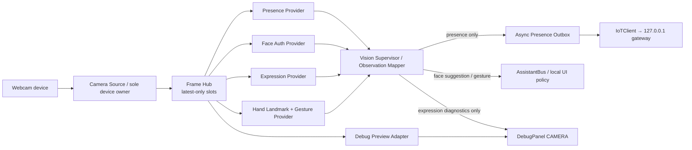
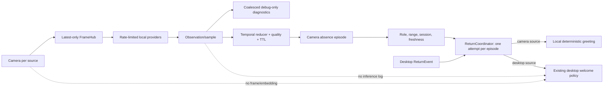

# Thiết kế kiến trúc Camera AI cho Alice

**Trạng thái:** Chủ máy đã báo thử nghiệm camera ổn và duyệt lời chào LLM + xác nhận tay/đầu. Nhánh camera LLM có client/budget riêng; phần tích hợp mới chưa được chạy thử trong phiên chỉnh sửa. Nhiều camera vẫn chưa triển khai.
**Phiên bản:** 0.6 · 2026-09-28
**Liên quan:** [Đặc tả](camera_ai_spec.md) · [Riêng tư/bảo mật](camera_ai_security_privacy.md) · [IoT proposal](iot-architecture-proposal.md)

Phần nối LLM hiện hành nằm tại [Camera LLM integration](camera_llm_integration.md): chỉ lời chào text có quota và pending confirmation deterministic.

### Bổ sung lớp thuật toán bàn tay · 2026-09-30

`hand_geometry.py` trích xuất một lần các góc khớp 3D, tỷ lệ khoảng cách 2D đã hiệu chỉnh tỷ lệ khung hình, độ mở bàn tay, pinch, hướng xoay và vị trí đầu ngón trỏ tạm thời. Quy tắc thumbs-up/OK và ngưỡng xác nhận đang dùng được giữ nguyên; pose tổng quát `open/fist/peace/point/other` là nhánh chẩn đoán riêng, lấy cảm hứng từ WonderSnap. `hand_motion.py` ổn định pose theo thời gian và nhận cạnh pinch cùng cử động vuốt ngang tương đối với kích thước tay. `CameraService` chỉ ghi các kết quả này ở debug panel; không phát sinh tool, LLM, click, scroll hay lệnh hệ thống. Mất tay, nhiều tay, pause và đổi thế hệ frame đều reset tracker. Không lưu frame hay chuỗi landmark.

Nhịp gesture hiện tại tối đa khoảng 5–6 mẫu/giây phù hợp với pose giữ lâu nhưng chưa đủ để cam kết nhận double tap hoặc snap ngắn. Tương tác con trỏ tương lai cần chế độ hoạt động, cadence và ngân sách CPU riêng, ánh xạ hướng có xét webcam mirror, vùng tọa độ, điều kiện bật/tắt, chống nhầm và benchmark trên máy đích. Không dùng `image_swipe_left/right` trực tiếp làm hành động OS.

## 1. Mục tiêu thiết kế

Kiến trúc cho phép Alice đọc một webcam local và cung cấp nhiều năng lực thị giác độc lập mà không nhân đôi quyền sở hữu camera, làm nghẽn UI/agent hoặc buộc các feature biết thư viện model. Camera vẫn là feature riêng. IoT nhận presence typed event; Face Auth, expression và gesture không đi qua IoT.

Tài liệu `iot-architecture-proposal.md` vẫn là nguồn đúng cho policy IoT hiện tại: camera presence + nhiệt độ dùng rule deterministic, camera offline/stale thì fail closed, và không có identity recognition trong IoT MVP. Tài liệu này mở rộng camera desktop theo giai đoạn; không thay đổi rule hoặc schema MQTT.

## 2. Hiện trạng và khoảng cách

Baseline hiện tại không còn là legacy đơn giản: `CameraService` có một capture owner, latest-frame slot, worker presence/Face Auth/Emotion/Gesture/preview và IoT presence outbox; debug panel CAMERA cho xem preview/overlay/diagnostic. Presence dùng Haar nếu có hoặc YuNet khi cần; Face Auth v1 opt-in cho một profile chủ máy; Emotion opt-in và debug-only; Gesture thumbs-up/OK chạy khi camera hoạt động. Chủ dự án đã thử các capability AI hiện tại trên webcam.

LLM text APIs không nhận camera frame. Camera event/log không được gửi trực tiếp sang LLM; gesture chỉ nối tới pending confirmation hiện hữu, còn Face Auth/Emotion không làm phát sinh Agent action. IoT chỉ nhận presence qua loopback theo schema hiện tại. Chi tiết implementation, thử nghiệm và số đo quan sát được ghi tại [đặc tả](camera_ai_spec.md).

Descriptor/role một webcam, proximity tương đối, episode Return riêng, coordinator hợp nhất desktop, head yes/no và bounded debug bus đã được nối. Ngày 2026-09-28 bổ sung adapter lời chào LLM có durable quota và bật xác nhận đầu theo lựa chọn chủ máy. Registry nhiều nguồn, head-pose model chuyên biệt và vision LLM vẫn chưa triển khai.

## 3. Kiến trúc đích



### Nguyên tắc

- **Một owner mở webcam:** không để từng model/provider tự mở lại device index.
- **Latest wins:** consumer chậm bỏ frame cũ; camera data không biến thành queue chậm ngày càng dài.
- **Mỗi capability độc lập:** presence, Face Auth, expression, gesture có cờ, tần suất, timeout, health và error riêng.
- **Events thay vì frame sharing ra domain:** model trả result; orchestrator tạo event typed; consumer nghiệp vụ không import OpenCV/InsightFace/MediaPipe.
- **Fail isolated:** lỗi model tùy chọn chỉ disable module đó; camera capture/UI và các module khác tiếp tục.
- **Không suy diễn absence:** thiếu frame, camera unavailable, timeout và no-face là các trạng thái khác nhau.
- **Policy ngoài model:** model không gọi IoT, LLM, agent, tool registry hoặc hành động OS.

## 4. Thành phần và trách nhiệm

### `CameraSource`

Target abstraction: source adapter sở hữu `VideoCapture`, backend, camera index, open/read/release và health; `read()` trả frame kèm sequence và timestamp monotonic/UTC. Trong baseline hiện tại, capture loop nằm trong `CameraService` và cấu hình một camera index; `LocalWebcamSource` là ranh giới thiết kế cho lúc cần registry/nhiều thiết bị, chưa phải module source tách riêng. Chỉ capture owner được gọi API driver.

Phần mở rộng đầu tiên thêm `CameraDescriptor` tối thiểu cho webcam hiện tại: nhãn, ID cấu hình local, role và capability. Registry nhiều nguồn chỉ làm khi cần camera thứ hai. `device_kind` (`integrated_webcam`, `usb_camera`, `ip_camera`, `unknown`) và `role` (`workstation_facing`, `room_observation`, `unknown`) là hai trường riêng; index số của OpenCV chưa xác minh ID phần cứng. Tách ID/role camera khỏi `IOT_CAMERA_ROOM_ID`. Source vật lý vẫn có đúng một owner. USB không tự hàm ý workstation-facing; IP/RTSP không được mở cho đến khi transport, credentials, reconnect và privacy được thiết kế riêng.

```python
FramePacket(
    camera_id: str,
    sequence: int,
    captured_at_utc: datetime,
    captured_at_monotonic: float,
    width: int,
    height: int,
    pixel_format: str,       # BGR8 hiện tại
    pixels: ndarray,         # read-only sau publish
)
```

Frame không được mutate sau khi publish. Consumer cần crop/resize thì tạo buffer riêng. Không đặt bytes frame vào log/event bus.

### `FrameHub`

Phân phối reference tới frame mới nhất cho consumer trong cùng process. Mỗi subscriber có slot capacity 1 hoặc `latest_frame()`; publish mới ghi đè frame chưa dùng. Ghi lại số frame bị skip để chẩn đoán throughput, không lưu frame cũ.

Nếu provider chuyển sang process riêng, chỉ thêm transport cụ thể (shared-memory ring buffer hoặc bounded pipe) sau benchmark. Không pickle/queue một luồng ảnh không giới hạn. Worker kiểm tra sequence và TTL trước inference để bỏ kết quả đã quá cũ.

### `VisionModule` / Provider Adapter

Contract khái niệm:

```python
class VisionModule(Protocol):
    module_id: str
    capability: str
    def start(self, config) -> None: ...
    def infer(self, frame: FramePacket) -> list[Observation]: ...
    def health(self) -> ModuleHealth: ...
    def stop(self) -> None: ...
```

Mỗi adapter chịu trách nhiệm model load/unload, preprocessing, throttling, inference timeout và map output sang schema trung lập. Adapter không import Tkinter hoặc gọi gateway. Model wrapper có thể được thay mà không đổi event consumer.

### Các module theo năng lực

| Module | Input/cadence dự kiến | Output | Ghi chú |
|---|---|---|---|
| Presence | Frame khoảng 1–2 Hz | `camera.face_presence_proxy` + confidence | Haar frontal-face nếu có; YuNet đã pin khi Haar không khả dụng. Cả hai là face-presence proxy, không phải person detector; adapter ánh xạ schema boolean IoT cũ |
| Face/Auth v1 | Frame đã có face crop, chỉ khi opt-in; khoảng 1–3 Hz hoặc yêu cầu gợi ý profile | profile-match suggestion / unknown, confidence band | Một profile chủ máy; không chứng minh danh tính hay làm Windows login; nhiều profile và chức năng khác để Face Auth v2 |
| Expression | Crop mặt, opt-in; tối đa khoảng 1 Hz trong bản đầu | expression label + score + TTL chỉ cho debug panel | Chỉ biểu cảm quan sát được; dưới ngưỡng tạm trả `unknown`, không lưu chuỗi frame; không đổi avatar/UI thường |
| Hand/Gesture | Mặc định chạy cùng camera; lấy frame mới tối đa khoảng 5 Hz | hand landmarks nội bộ; `thumbs_up`/`ok` | MediaPipe VIDEO mode; một tay; giữ pose 0,7 s; phát một lần rồi chờ thả tay |
| Diagnostic preview | Chỉ khi panel visible; tối đa 4 Hz UI | latest JPEG/BGR rendered tại chỗ | Encode tối đa 640px, overlay; không disk/network |

Cadence là giá trị khởi điểm đo hiệu năng, không phải fixed API. Capture source cần cung cấp frame đủ thường xuyên cho module đang hoạt động. Pause/stop camera dừng tất cả consumer gồm gesture.

### `VisionSupervisor`

Khởi tạo provider theo cấu hình, theo dõi health, quản lý worker lifecycle/restart/backoff và tắt riêng module lỗi. Supervisor không quyết định hành động nghiệp vụ. Không nạp model weights nếu module disabled.

### `ObservationMapper` và consumers

Map observation sang các bề mặt hiện có:

- legacy face-presence proxy → `IoTClient.presence(room_id, present, confidence)` qua outbox bất đồng bộ; giữ TTL phía gateway. Không đổi tên thành person detection.
- profile-match suggestion → chỉ hiển thị trong local UI; không thay đổi hồ sơ chủ máy hiện đang hoạt động.
- expression estimate → chỉ qua adapter chẩn đoán của debug panel; không chuyển vào `AssistantBus.emotion`, persona, agent, IoT, voice hoặc UI thường.
- gesture → callback nhận label đã debounce. Khi có pending action từ trước, adapter gọi cùng `agent.confirm_pending("yes")` dưới agent lock như nút xác nhận/voice. Thumbs-up còn cập nhật mood như lời khen. Không khởi tạo yêu cầu agent mới.
- camera/module health → `CameraService.diagnostics()` và tab CAMERA.

## 5. Mô hình thread/process

### Baseline đề xuất

```text
Tk main thread       : render preview/status; không decode/infer
Capture thread       : duy nhất đọc/release webcam; publish frame mới nhất
Vision worker(s)     : mỗi capability có cadence và bounded slot
Presence outbox      : gửi trạng thái IoT; timeout/retry không block capture
AssistantBus poller  : nhận typed events và cập nhật UI trên Tk thread
```

Ban đầu giữ workers cùng process để tránh cold start/overhead đóng gói trên Windows. Có thể dùng thread worker cho ONNX/MediaPipe runtime nếu backend native hoạt động đúng; benchmark xác định mức song song phù hợp. Không giả định thêm thread luôn tăng throughput: nhiều model cùng CPU/GPU có thể làm tăng latency.

Timeout của thread chỉ đánh dấu kết quả stale/degraded; Python không thể cưỡng bức dừng an toàn lời gọi native đang treo. Nếu cần restart/cancel cứng, provider đó phải được cô lập trong process trước khi bật rộng rãi.

### Khi nào tách process

Tạo một tiến trình `vision_worker` riêng (không phải một process cho từng task nhỏ) nếu benchmark cho thấy một hay nhiều điều sau: model load làm tăng startup đáng kể, provider native làm crash host, inference chiếm tài nguyên làm ảnh hưởng voice/UI, cần restart độc lập, hoặc runtime GPU không ổn định khi chung process. Chỉ chuyển frame qua bounded IPC và theo dõi worker heartbeat/timeout. Windows `spawn`, app đóng gói, shutdown/join, model cache và RAM tăng thêm phải được thử trước khi chọn cách này.

### Backpressure và freshness

- Frame Hub không đợi consumer.
- Worker lấy latest frame, kiểm tra `captured_at` và bỏ frame quá TTL.
- Nếu inference đang chạy, frame mới thay thế pending frame; không tích lũy backlog.
- Một frame tạo kết quả có thể gắn sequence; preview/log ghép đúng sequence.
- Provider treo quá timeout được đánh dấu degraded; supervisor có thể restart theo backoff.
- Capture reconnect có delay; sau reconnect tăng generation id để result từ camera session cũ bị bỏ.

## 6. Event contract

### Envelope

```json
{
  "event_id": "uuid",
  "schema_version": 1,
  "kind": "camera.face_presence_proxy",
  "camera_id": "local-webcam-0",
  "provider_id": "opencv-haar-legacy",
  "provider_version": "pinned-version",
  "frame_sequence": 2481,
  "captured_at": "RFC3339 UTC",
  "inferred_at": "RFC3339 UTC",
  "expires_at": "RFC3339 UTC",
  "status": "unknown",
  "confidence": null,
  "payload": {}
}
```

Envelope luôn có thời gian nhận diện và expiry để consumer không coi event stale là state hiện thời. Confidence phải là số do provider cung cấp và được ghi chú semantics; không gán `1.0` giả để biểu diễn boolean.

### Payload boundaries

- `camera.face_presence_proxy`: `present`, confidence, room; legacy Haar face detector không khẳng định phòng có/không có người.
- `person.presence`: chỉ phát khi có provider detect người thực sự; không tái sử dụng kết quả Haar.
- `face.profile_match_suggestion`: `matched`, `not_matched`, `unknown`; chỉ hiển thị gợi ý cho chủ máy khi opt-in, không chuyển profile. Không tuyên bố identity verification; không có embedding/crop. Liveness status chỉ được thêm theo use case đã duyệt.
- `face.expression_estimate`: allowlisted expression label, confidence band, TTL. Không có free-form mental-state text.
- `hand.gesture`: label `thumbs_up`/`ok`, quality, hand count, frame sequence; không có landmark hay arbitrary command string.
- `camera.workstation_proximity` (future): `near`/`far`/`unknown`, `visibility` (`single_face/no_face/multiple_faces/degraded`), quality, valid-sample count, dwell, TTL; không có số mét hay bounding box. Chỉ local reducer/ReturnCoordinator sau khi role/calibration hợp lệ.
- `camera.workstation_near_candidate` (future): event ID, coordinator-assigned absence episode ID, camera ID/role, near band, quality, first/last sequence, expiry; ReturnCoordinator nhận candidate, chưa phải SALM ReturnEvent.
- `head.gesture` (future): allowlisted `yes`/`no`/`unknown`, quality, sequence window và pending-confirmation ID; không có command tự do hoặc landmarks.
- `camera.health`: state, error code, frame age, capture/inference latency và dropped-frame counters.

Frame payload không được đặt trong contract chung. Debug image chỉ đọc qua in-process diagnostics API khi panel đang visible.

## 7. State machine và lỗi

### Camera lifecycle

```text
disabled → stopped → starting → available ↔ degraded
                               └→ unavailable → retry-wait → starting
available/degraded → stopping → paused/stopped
paused → starting (explicit resume)
```

`present=false` khác `unknown`: false từ detector chỉ có nghĩa detector đang chạy nhưng không thấy đối tượng theo định nghĩa của nó trong mẫu đủ chất lượng. Với Haar hiện tại, đó là `camera.face_presence_proxy=false`, không phải bằng chứng phòng trống. `unknown/unavailable` dùng cho camera pause/offline, model lỗi, frame stale, worker timeout hoặc module tắt. API boolean IoT hiện tại có thể nhận `false` khi pause/offline để thu hồi positive state cũ/fail closed; UI và telemetry local vẫn phải thể hiện unknown/unavailable, không suy ra không có người. Gateway hiện chỉ cho auto-on khi nhận `present=true` còn hạn; false hoặc hết TTL đều chặn auto-on và không kích hoạt action dựa trên absence. Nếu cần hành động khi phòng vắng, schema phải được nâng cấp sang `present/absent/unknown` để phân biệt quan sát âm với camera mất kết nối. Gateway giữ state trong bộ nhớ có TTL; Alice không forward event đó sang MQTT/LAN/cloud. Việc forward trong tương lai cần quyết định riêng về consent, schema và retention.

### Module lifecycle

```text
disabled → loading → ready → degraded → stopping → stopped
                         └→ failed (retry theo policy hoặc giữ disabled)
```

Dependency/model không có: báo module `unavailable` với mã lỗi, không làm `CameraSource` chết. Restart provider có backoff và không lặp log mỗi frame.

## 8. Tích hợp repo Alice

- Giữ package camera tại `src/features/camera/`; tách dần `source.py`, `pipeline.py`, `providers/`, `observations.py` khi logic đủ lớn.
- `CameraService` hiện là adapter ngoài giữ API lifecycle và diagnostics tương thích; facade này không biết tên model.
- `FeatureContext.camera` vẫn trỏ CameraService. Feature `iot` chỉ tiêu thụ presence API/event, không import provider implementation.
- `AssistantBus` là đường duy nhất từ worker tới Tk. Tk widgets chỉ cập nhật trong `_poll` hoặc callback `after`.
- `CameraService` không gọi LLM. Việc hiện tại gửi presence qua loopback giữ nguyên payload; triển khai pipeline tách send sang outbox thread/queue để timeout HTTP không block camera.
- Không nối camera sample/log vào Agent prompt hoặc LLM. Workstation Return dùng episode camera riêng, coordinator hợp nhất desktop Return; mode `llm` đi qua adapter text riêng và SQLite quota trước call, mode `local` dùng câu có sẵn. Candidate không vào SALM storage; ledger quota chỉ lưu hash attempt và timestamp, không lưu camera observation.
- IoT Gateway hiện giữ presence volatile trong bộ nhớ theo TTL; code path hiện tại không forward state này sang MQTT/LAN/cloud. UI thường phải có camera indicator và pause/disable độc lập debug panel; ẩn panel chỉ dừng preview.
- LLM image input chưa tồn tại trong `src/llm/client.py`/`src/llm/gemini.py`; bổ sung nó là dự án riêng có consent/transport/privacy design, không nằm trong task camera AI local.
- Camera debug panel hiện poll diagnostics khi hiện. Không tạo thêm capture handle hoặc lưu history frame.

## 9. Model/dependency policy

| Candidate | Vị trí | Điều kiện trước khi chọn |
|---|---|---|
| InsightFace | Face detection/recognition/alignment hoặc liveness provider | Pin chính xác code/model/runtime; code MIT không bao trùm model weights. README/model zoo ghi pretrained models theo điều khoản nghiên cứu phi thương mại; cần xác minh quyền dùng weights cụ thể trước phân phối |
| EmotiEffLib | Expression estimation | Hỗ trợ backend PyTorch và ONNX, code Apache-2.0; pin model/backend và kiểm tra chất lượng trên webcam Alice |
| MediaPipe Hand Landmarker | Landmark provider cho gesture | Dùng API/tasks tương thích desktop Python/runtime; pin `.task` model, checksum, license và đo latency |

Không cài cả PyTorch, ONNX Runtime, InsightFace và MediaPipe vào requirements lõi mặc định. Tạo extras hoặc môi trường vision tách rời; gesture nạp model khi camera chạy, các capability opt-in khác nạp khi bật. Model metadata gồm `provider`, `model_id`, `model_version`, `license`, `checksum`, `input_size`, `backend`, `device`, `created_at`.

### Cấu hình triển khai đã cung cấp

Laptop AMD Ryzen 5 5500U, AMD Radeon Graphics tích hợp, RAM 16 GB là máy baseline. Phải benchmark CPU inference trên máy này; không yêu cầu CUDA hoặc GPU rời. Có thể thử iGPU acceleration sau nếu provider/runtime hỗ trợ ổn định trên đúng driver và bản đóng gói. Chủ dự án dùng Alice cho cá nhân, không thương mại; vẫn phải kiểm tra điều khoản của weights cụ thể vì license code và license model có thể khác nhau.

## 10. Triển khai theo lát cắt

### Slice A — Panel chẩn đoán

Kiểm tra tab CAMERA đang được nối; hoàn tất lỗi/thành công states; hiển thị preview, overlay, sequence và inference latency; xác minh hide/show dọn frame; thêm camera indicator và pause/disable ngoài debug panel. Không thêm model mới.

### Slice B — Capture/presence pipeline

Tạo `FramePacket`, source owner, FrameHub slot capacity 1, presence adapter và async outbox. Chạy detector hiện có như provider chuyển tiếp để so sánh kết quả. Benchmark baseline CPU/RAM trên Ryzen 5 5500U. Bật feature flag rollback.

### Slice C — Face Auth

Một template chủ máy, provider version pin, enrollment/delete, fallback và log metadata không chứa template. v1 chỉ hiển thị gợi ý; hồ sơ chủ máy luôn hoạt động như trước. Các chức năng khác của Face Auth, multi-profile, liveness/spoof, FAR/FRR hoặc protected action chỉ thuộc scope riêng Face Auth v2.

### Triển khai hiện tại (2026-09-27)

- `src/features/camera/service.py`: một capture owner, presence khoảng 2 Hz bằng Haar khi có hoặc YuNet khi OpenCV không có Haar, worker gợi ý Face Auth opt-in và preview trong RAM. `pipeline.py` có latest-frame slot capacity 1 và outbox IoT bất đồng bộ. Đây là triển khai cùng process; chưa có process worker vì chưa benchmark laptop đích.
- Trên OpenCV 5.x không còn `CascadeClassifier` trong gói chính; presence chuyển sang YuNet đã pin khi Haar không có. Worker preview riêng vẫn mã hóa ảnh gốc khi detector lỗi hoặc chậm; lỗi detector không làm mất ảnh debug. YuNet 2023mar được thử ở kích thước frame trước, rồi dùng input 320×320 và đổi tọa độ về frame gốc nếu backend yêu cầu shape cố định.
- `src/features/camera/face_auth.py`: YuNet 2023mar + SFace 2021dec qua OpenCV DNN CPU. Model được tải thủ công bằng `packaging/install_camera_models.py`, SHA-256 được xác minh mỗi lần nạp. Face Auth mặc định tắt, thu 5 mẫu khi người dùng đồng ý, lưu embedding đã mã hóa Windows DPAPI `CurrentUser` và khóa ACL theo SID Windows hiện tại.
- `src/ui/avatar.py`: badge camera luôn hiện, mở panel điều khiển pause/resume, bật/tắt gợi ý, enrollment/cancel/delete. Panel debug camera hiển thị state, frame sequence, latency, ảnh có overlay và log. Kết quả `matched` không gọi `Agent`, tool, IoT, profile/memory service hoặc quyền OS.
- `src/features/camera/emotion.py`: EmotiEffLib `enet_b0_8_best_afew.onnx` qua ONNX Runtime CPU, tự detect đúng một mặt bằng YuNet, crop RGB 224×224 và chuẩn hóa theo upstream. Worker riêng chạy tối đa khoảng 1 Hz trên latest frame; mặc định tắt, chỉ bật từ tab CAMERA của debug panel. Ẩn panel tắt worker và xóa estimate trong RAM. Log chỉ có label/quality/confidence/sequence/latency, không có frame/crop. Không đi vào `AssistantBus.emotion`, avatar, agent, IoT hoặc log file thông thường. `src/requirements-emotion.txt` và `packaging/install_camera_models.py --emotion` là bước cài riêng; ứng dụng không tự tải weights.
- `src/features/camera/gesture.py`: MediaPipe Hand Landmarker 1.0.1 VIDEO mode với model float16 v1 từ Google; classifier hình học cho thumbs-up/OK và debouncer giữ/thả/cooldown. Worker riêng lấy latest frame khoảng 5 Hz, mặc định chạy cùng camera, chỉ giữ metadata trong RAM. Debug panel hiện trạng thái và mẫu. Adapter trong `app.py` chỉ tiêu thụ pending confirmation có sẵn qua `agent.confirm_pending("yes")`; thumbs-up còn cập nhật mood như lời khen. Không có gesture activation mode.
- Đã nhận năm cặp log thực tế của chủ máy ở điều kiện bình thường, nghiêng mặt, đeo kính và thiếu sáng; mọi gợi ý đều `matched`. Với toàn bộ Alice, CPU được báo là 0,8–1% khi tắt camera, 4,8–6,5% khi bật camera nhưng tắt Face Auth, 9,1–15% khi bật cả hai; RAM khoảng 1.200–1.300 MB trong cả ba cấu hình. Một ảnh người khác trên điện thoại trả `not_matched` score 0,061. Bảng số đo và giới hạn diễn giải nằm trong `camera_ai_spec.md`. Chưa có bộ mẫu âm đa dạng hoặc đo CPU/RAM kéo dài; giữ nguyên ngưỡng `0.50`. Các số đo hiện có chưa tạo lý do để chuyển worker sang process riêng. Ngưỡng này chỉ phục vụ gợi ý tiện ích và chưa đủ cho use case an ninh.
- Face Auth chỉ tính phiếu khớp khi frame có đúng một mặt đủ chất lượng. Frame nhiều mặt/không mặt/chất lượng thấp xóa cửa sổ phiếu, trả `unknown`; log ghi `quality`, số phiếu dương và độ dài cửa sổ để giải thích gợi ý. Sau frame không hợp lệ, cần đủ ba mẫu hợp lệ mới đưa ra `matched` hoặc `not_matched`.
- Diagnostics tách kết quả detector ở mẫu mới nhất (`face_count`, `presence_sequence`) khỏi trạng thái presence đã lọc. Khi không thấy mặt nhưng đang trong khoảng giữ tối đa 5 giây, UI/log hiển thị `held`; `last_seen_at` chỉ cập nhật từ mẫu thật sự thấy mặt.

| Model | Nguồn/giấy phép thư mục OpenCV Zoo | SHA-256 của tệp đã pin | Kích thước |
|---|---|---|---:|
| `face_detection_yunet_2023mar.onnx` | [YuNet, MIT](https://github.com/opencv/opencv_zoo/blob/main/models/face_detection_yunet/README.md) | `8f2383e4dd3cfbb4553ea8718107fc0423210dc964f9f4280604804ed2552fa4` | 232.589 byte |
| `face_recognition_sface_2021dec.onnx` | [SFace, Apache-2.0](https://github.com/opencv/opencv_zoo/blob/main/models/face_recognition_sface/README.md) | `0ba9fbfa01b5270c96627c4ef784da859931e02f04419c829e83484087c34e79` | 38.696.353 byte |
| `enet_b0_8_best_afew.onnx` | [EmotiEffLib model](https://github.com/sb-ai-lab/EmotiEffLib/tree/main/models/affectnet_emotions/onnx); code Apache-2.0, kiểm tra quyền phân phối weights riêng | `7aa2ea31c1311f4f8aa9d3fdb085d418dd4e7a48c4b9ed41df8c044f91d0213f` | 16.039.595 byte |
| `hand_landmarker_float16_v1.task` | [Google MediaPipe Hand Landmarker](https://developers.google.com/edge/mediapipe/solutions/vision/hand_landmarker/index); kiểm tra điều khoản artifact khi phân phối | `fbc2a30080c3c557093b5ddfc334698132eb341044ccee322ccf8bcf3607cde1` | 7.819.105 byte |

OpenCV Zoo ghi YuNet 2023mar có input shape cố định và tương thích OpenCV 4.x DNN theo kích thước ảnh thực tế. Vì vậy requirements được giới hạn `<5.0` cho bản này; nâng OpenCV/model là thay đổi cần kiểm tra riêng.

### Slice D — Expression

Provider độc lập, opt-in, cadence thấp. Kết quả, trạng thái và lỗi chỉ ghi vào debug panel với nhãn “ước lượng biểu cảm” và `unknown` khi chất lượng thấp. Không có nhãn, badge, overlay, notification hoặc thay đổi khuôn mặt avatar trên UI thường; không phát `AssistantBus.emotion`. Không lưu timeline thô, không cá nhân hóa và không tự điều khiển persona. Cờ bật/tắt và health nếu được điều khiển qua UI chỉ nằm trong debug panel.

### Slice E — Gesture

MediaPipe landmark provider, classifier hai pose, debouncer và debug health. Luôn chạy cùng camera; pause là kill switch. Chỉ xác nhận pending action qua đường agent hiện có, không gọi tool trực tiếp.

### Slice F0 — Ranh giới event và đo baseline

Bus debug giới hạn 1024 event và ghi dropped count; sample log camera giảm nhịp. `ReturnCoordinator` tách camera welcome khỏi callback desktop; adapter camera có local fallback và optional text LLM qua quota riêng. Chủ máy đã báo thử nghiệm camera ổn; chưa có benchmark full stack mới hoặc chạy thử nhánh LLM camera trong phiên chỉnh sửa.

### Slice F — Descriptor camera và role policy

Giữ một source local mặc định; thêm descriptor tối thiểu cho nhãn/vai trò và allowlist. Không hứa nhận dạng phần cứng ổn định từ camera index. Capability Router chặn Face/Auth, expression, hand/head gesture và proximity nếu camera role không phải `workstation_facing`. Không thêm full registry hoặc IP/RTSP trong lát cắt này.

### Slice G — Proximity shadow mode

Tái dùng bounding box từ presence detector để ước lượng `near/far/unknown` từ tỷ lệ kích thước mặt chuẩn hóa/ROI, baseline per camera, số mẫu hợp lệ tối thiểu và temporal hysteresis; không mở detector khác. `no_face` chỉ là visibility observation khi camera khỏe, không tự động là absence. Chỉ log summary ở CAMERA panel; chưa nối SALM. Không xuất ra mét hoặc dùng nó như ranh giới an ninh.

### Slice H — Workstation Return shadow/coordinator

Camera theo dõi episode riêng: `near` đã thấy → `far` hoặc `no_face` khỏe đủ lâu → `near` ổn định mới. Blur/unknown/reconnect/startup không tính absence. Coordinator hợp nhất desktop Return và chỉ thử chào một lần; camera không thay SALM presence/clock/care/IoT. Không chào khi locked/suspended; unavailable giữ desktop-only behavior. Mode local dùng template; mode llm dùng adapter/client riêng với durable quota, không dùng client desktop. Request hết hạn sau 10 giây và kiểm near/source/freshness trước call và output. Candidate ở RAM/debug; SQLite camera chỉ giữ attempt hash/time; desktop event vẫn lưu như hiện tại.

### Slice I — Head Gesture proof of concept và gesture catalog

Head-motion proof of concept hiện tái dùng năm landmark YuNet từ presence worker ở shadow mode; chưa có model head pose chuyên dụng hoặc benchmark độ chính xác. Gật/lắc đầu chỉ map yes/no khi `CAMERA_HEAD_CONFIRMATION_ENABLED=true` và pending confirmation đã tồn tại trước lúc cử chỉ bắt đầu. Visual-confirmation arbiter chung với hand kiểm cùng lock/ID; kết quả trái nhau trong cửa sổ 0,8 giây khi head bật (0,4 giây khi chỉ hand) bị bỏ trước side effect. Cửa sổ cần đo lại theo cadence/p95 thực tế. Gesture bàn tay khác vẫn chờ mapping được chủ dự án chọn.

### Slice J — Event safeguards cho mọi consumer

Latest-only sample path, temporal reducer, event ID cộng absence episode dedupe, single-consumer action, event TTL, per-source cooldown và bounded debug queue. Camera samples/labels/errors không bao giờ trực tiếp gọi LLM. Camera Return bản đầu có API budget bằng 0 do local-only. Chi tiết tại FR-501–507 của spec.

## 11. Event SALM và bảo vệ chi phí cho phần mở rộng



### Workstation Return reducer

- Camera phát candidate ngắn hạn `workstation_near_candidate` sau episode `near → far/healthy no_face → near`, không phát lời chào hoặc action trực tiếp. `unknown`, pause, blur và reconnect không được tính là absence.
- Candidate chỉ hợp lệ với source local được chọn rõ `workstation_facing`, calibration hiện hành, frame mới, `near` ổn định, chất lượng đủ và một mặt. Dwell phải đi cùng số mẫu hợp lệ tối thiểu theo p95 cadence đo thực tế.
- SALM desktop tiếp tục quyết định ReturnEvent riêng theo AWAY/SUSPENDED→PRESENT; camera episode không phải phụ thuộc transition đó vì desktop `PRESENT` có thể do media và `AWAY` có thể do idle khi người vẫn ngồi. Coordinator chỉ đọc session lock/suspend làm veto, không sửa presence hoặc policy khác của SALM.
- Camera và desktop event cùng lượt return được coordinator gán `absence_episode_id`: coordinator quan sát SALM transition và camera episode theo monotonic clock trong cùng process, tương quan các khoảng vắng/thứ tự transition/cửa sổ hiệu chỉnh. Không suy monotonic time từ `ReturnEvent.at` wall-time; `ReturnEvent.origin` hiện là lý do AWAY/SUSPENDED, không phải source camera/desktop. Event ID riêng không đủ khử lặp. Coordinator phải đứng trước callback chào desktop hiện tại để hai nguồn không dispatch độc lập. Mỗi episode được thử tối đa một proactive greeting trong phiên process; restart camera về `unknown`, desktop giữ hành vi cũ. Candidate camera không lưu vào SALM storage; desktop ReturnEvent vẫn được lưu như hiện tại.
- Khi camera tắt/unavailable/unknown, luồng desktop-only hiện có tiếp tục; lỗi camera không tự tạo lời chào.

### LLM cost circuit breaker

- Camera source, vision worker, observation mapper và debug panel không gọi/import LLM client hoặc Agent router. Adapter `camera/welcome.py` là consumer riêng tại composition root, nhận request đã qua coordinator và chịu quota trước call.
- Camera Return có mode `off/shadow/local/llm`. `CameraReturnWelcome` tái dùng prompt/validator qua instance `WelcomeDialogue` riêng, với `before_call` và `status_sink`; không dùng instance/client desktop. Owner đã chọn `llm` ngày 2026-09-28. Desktop return giữ policy hiện hành.
- Quota camera reserve nguyên tử qua SQLite trước call: khoảng cách 900 giây, tối đa 3/giờ và 12/24 giờ, tính lỗi/timeout, giữ qua restart. Client một model, retry=0, output bounded và deadline; denied/error dùng fallback. Mã camera/desktop Return hợp nhất episode trước dispatch. Chi tiết và giới hạn phạm vi quota ở [integration design](camera_llm_integration.md).
- Giữ `ReturnWelcomeTracker` desktop hiện tại: min absence 120 giây / cooldown 300 giây. Camera episode có duration/cooldown riêng được hiệu chỉnh; coordinator hợp nhất theo episode để không chào hai lần.
- Presence/emotion/gesture/head diagnostics không phải API caller. `AssistantBus._debug_q` hiện có capacity 1024 và dropped counter; camera sample log giảm tần suất. Ghi transition/error ưu tiên; summary latency định kỳ và số đo thật trên máy đích còn là gate tiếp theo.

## 12. Kiểm chứng kiến trúc

### Kiểm thử tự động cần có khi implement

- Fake camera source: frame seq tăng, reconnect generation mới, read fail, empty frames, release đúng một lần.
- FrameHub: slot bị ghi đè, worker chậm không tạo backlog, frame stale bị bỏ.
- Worker isolation: provider timeout/error/exception không dừng capture hoặc module còn lại.
- Event schemas: confidence range/semantics, timestamps, expiry, payload cấm ảnh/embedding.
- Outbox: IoT timeout/retry không block capture; duplicate event không làm policy thực thi lặp.
- Lifecycle: start/stop/start, shutdown khi worker đang chạy, restart camera.
- Gesture: debounce, cooldown, pause, nhiều tay, pose không rõ, chỉ hai label và pending confirmation có sẵn.
- Privacy: panel hide xóa preview, logs redaction, không ghi ảnh/artifact ra disk.

### Benchmark thủ công trên máy đích

Đo baseline CPU/RAM/startup cho camera không model, từng module và kết hợp trên Ryzen 5 5500U/16 GB; preview/input age/inference p50/p95; dropped frame count; nhiệt CPU (và GPU nếu thử iGPU) trong 15 phút; restart model/camera; ảnh sáng/yếu, góc mặt, kính, nhiều người và gesture ngoài ý muốn. Chọn process boundary sau kết quả này.

## 13. Architecture decisions

| ID | Quyết định đề xuất | Lý do | Tác động |
|---|---|---|---|
| ADR-CAM-01 | Tách provider theo capability, không dùng một model all-in-one | Các output/cadence/risk khác nhau | Thêm adapter/contracts, giảm coupling |
| ADR-CAM-02 | Một owner webcam, latest-frame bounded channels | Tránh tranh camera và queue trễ | Frame cũ bị bỏ khi model chậm |
| ADR-CAM-03 | Bắt đầu worker cùng process; process riêng khi benchmark chứng minh cần | Giảm packaging/IPC/RAM phức tạp ban đầu | Giữ seam IPC để tách sau |
| ADR-CAM-04 | Frame không đi qua event bus; event chỉ mang metadata | Tránh copy/lộ ảnh và payload phình | Preview qua diagnostics local |
| ADR-CAM-05 | Presence là capability IoT duy nhất ở giai đoạn nền | Giữ policy IoT deterministic | Không gửi auth/emotion/gesture tới gateway |
| ADR-CAM-06 | Face Auth và expression opt-in; gesture mặc định chạy cùng camera | Quyết định của chủ máy 2026-09-27 | Pause camera dừng gesture; trạng thái riêng trong debug panel |
| ADR-CAM-07 | Chỉ thumbs-up và OK xác nhận pending action qua đường có sẵn | Đồng nghĩa lời nói "đồng ý"; thumbs-up còn là lời khen | Không hỗ trợ arbitrary action; cần QA accidental trigger |
| ADR-CAM-08 | Emotion chỉ phát log vào debug panel | Chủ dự án không muốn AI biểu cảm xuất hiện trên UI Alice | Không nối output model vào `AssistantBus.emotion`, avatar, HUD, notification hoặc các consumer nghiệp vụ |
| ADR-CAM-09 | Phân biệt device kind và camera role; capability được allowlist theo role | Camera USB trong tương lai có thể nhìn bàn làm việc hoặc nhìn phòng | Workstation AI chỉ chạy trên source đã chỉ định; IP/RTSP cần review riêng |
| ADR-CAM-10 | Khoảng cách chỉ là `near/far/unknown` tương đối với calibration của camera | Face-box size phụ thuộc FOV, zoom, góc, độ phân giải và vị trí | Không xuất số mét; invalid calibration trả unknown |
| ADR-CAM-11 | Camera có absence episode riêng; ReturnCoordinator chỉ hợp nhất lời chào với SALM desktop | Nhận ra người vừa ngồi trước khi tương tác, tránh phụ thuộc SALM `PRESENT` từ media | Không sửa presence/clock/care/IoT; một lần thử chào/episode; desktop fallback |
| ADR-CAM-12 | Camera greeting theo nguồn và quota riêng | Ngăn blur/label flapping hoặc retry tạo API call liên tục | Local-only ở bản đầu; ngày 2026-09-28 mở mode llm có durable budget, client một model, không retry; xem integration design |
| ADR-CAM-13 | Head/hand gestures qua một visual-confirmation arbiter | Tránh race và xác nhận trái nhau trước side effect | Pending/pose time/ID check chung; xung đột bị bỏ; gesture mới cần mapping/QA |

## 14. Tham chiếu

- [InsightFace README/license và model policy](https://github.com/deepinsight/insightface/blob/master/README.md) · [Model Zoo details](https://github.com/deepinsight/insightface/blob/master/python-package/docs/model_zoo.md)
- [EmotiEffLib README](https://github.com/sb-ai-lab/EmotiEffLib)
- [MediaPipe Hand Landmarker guide](https://developers.google.cn/edge/mediapipe/solutions/vision/hand_landmarker)
