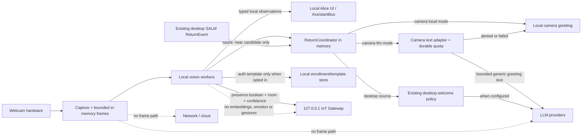

# Yêu cầu riêng tư và bảo mật cho Camera AI

**Trạng thái:** Chủ máy đã báo camera thử ổn, duyệt lời chào LLM và xác nhận tay/đầu. LLM camera chỉ viết lời chào text qua quota riêng; Face Auth/Emotion giữ phạm vi local. Phần tích hợp mới chưa được chạy thử trong phiên chỉnh sửa.
**Phiên bản:** 0.6 · 2026-09-28
**Tài liệu liên quan:** [Đặc tả](camera_ai_spec.md) · [Kiến trúc](camera_ai_architecture.md)

## 1. Nguyên tắc

1. Webcam chỉ xử lý trên máy Alice; frame không mặc định rời process/máy.
2. Camera đang hoạt động phải nhìn thấy được và có thao tác pause/disable dễ tìm.
3. Face Auth và expression là các capability opt-in độc lập. Gesture mặc định chạy khi camera chạy theo quyết định chủ máy; bật camera presence không đồng nghĩa đồng ý enrollment/face template.
4. Chỉ giữ dữ liệu cần cho một thao tác đang diễn ra. Không lưu video/ảnh/face crop mặc định.
5. Tách kết quả nhận diện khỏi danh tính cho tới khi user consent; không đưa biometric data vào log, IoT, LLM, telemetry hoặc crash dump do ứng dụng tạo.
6. Không dùng confidence model làm bảo đảm an ninh. Hành động nhạy cảm cần cổng riêng, fallback và xác nhận rõ.
7. Camera observation và log không phải lời gọi LLM. Camera Return đi qua temporal filter, policy gate và coordinator trong RAM; owner đã duyệt mode `llm` cho lời chào text với quota SQLite và client riêng. Raw frame/label không vào prompt; có local fallback. Xem [thiết kế tích hợp](camera_llm_integration.md).
8. Loại thiết bị và vai trò camera được tách riêng. Capability workstation không chạy trên camera phòng hoặc source chưa phân loại.

## 2. Phân loại dữ liệu

| Dữ liệu | Mục đích | Nơi xử lý | Thời gian giữ mặc định | Được gửi đi? |
|---|---|---|---|---|
| Raw camera frame | CV inference/preview | Memory trong capture process; shared reference trong cùng process | Chỉ đủ xử lý frame; không persist | Không |
| Debug preview JPEG | Kiểm tra ảnh/overlay | Memory khi CAMERA tab visible | Xóa khi ẩn panel/dừng service | Không |
| Face crop | Face/Auth/expression inference | Memory module provider | Hủy sau inference | Không |
| Face embedding/template | Face Auth nếu user bật và enrol | Kho local bảo vệ riêng | Tồn tại tới khi chủ máy xóa enrollment; tắt matching chỉ ngừng dùng, không tự xóa template hiện tại | Không |
| Profile-match suggestion | Chỉ hiển thị gợi ý local | UI nội bộ; không đổi hồ sơ chủ máy | Event TTL ngắn; không lưu lịch sử mặc định | Không |
| Expression estimate | Chẩn đoán model khi opt-in | Provider local → chỉ debug panel | Estimate hiện tại có TTL ngắn; log phiên giới hạn trong RAM, xóa khi clear/thoát | Không |
| Hand landmarks | Phân loại thumbs-up/OK khi camera chạy | Local worker memory | Frame hiện tại; không persist | Không |
| Proximity band `near/far/unknown` (future) | Loại bớt tín hiệu ở xa cho workstation return | Reducer local theo calibration từng camera | TTL ngắn; calibration metadata nhỏ nếu bật, không có ảnh | Không |
| Head pose/gesture `yes/no/unknown` (future) | Pending confirmation của Alice | Local worker memory | Chuỗi landmark/góc chỉ tồn tại trong lúc phân loại; event ID ngắn hạn | Không |
| Workstation near candidate / camera absence episode | Quyết định một lần thử chào | RAM tại ReturnCoordinator; debug chỉ ghi reason/counter | Trong phiên; không vào SALM storage | Observation/episode không gửi; có thể yêu cầu LLM viết lời chào generic |
| Camera LLM quota ledger | Giới hạn số camera welcome attempt qua restart | SQLite local độc lập | Attempt giữ tối đa cửa sổ 24 giờ; high-water clock giữ tới khi xóa store | Không; chỉ hash khóa attempt và timestamp |
| Desktop ReturnEvent (hiện có) | SALM chào khi desktop AWAY/SUSPENDED → PRESENT | SALM runtime/storage | Theo chính sách lưu trữ SALM hiện có | Lời chào desktop có thể dùng text LLM theo cấu hình hiện tại |
| Camera source metadata (future) | Chọn webcam/camera và capability | Config local | Tới khi chủ máy đổi cấu hình; tránh serial/IP nhạy cảm | Không |
| Presence event | IoT room policy | IoT API loopback có token | Gateway giữ state volatile theo TTL hiện tại | Có, chỉ `room_id/present/confidence` tới 127.0.0.1 |
| Debug log | Vận hành | Debug panel/in-memory queue | Panel giới hạn dòng; producer bus hiện giới hạn 1024 event và báo số bị bỏ | Không |

Embedding là dữ liệu nhạy cảm có thể liên kết danh tính, dù không phải ảnh gốc. Chỉ cho phép lưu template mã hóa trong kho local được bảo vệ theo user OS; không lưu raw source image/crop, template trong log, network payload, roaming/cloud backup, hoặc bản sao file không bảo vệ.

### Cơ chế bảo vệ template Windows v1 (hiện thực)

- Lưu một template đã enrol trong thư mục dữ liệu cục bộ của Alice dưới `%LOCALAPPDATA%`; đặt ACL giới hạn user Windows hiện tại.
- Mã hóa bytes template bằng Windows DPAPI với scope `CurrentUser` qua `CryptProtectData`; không tự sinh/lưu khóa mã hóa trong config. Không dùng scope `LocalMachine` vì mọi user/process trên máy có thể giải mã dữ liệu theo scope này.
- Chỉ ghi ciphertext ra đĩa; giải mã trong memory ngay trước inference, xóa buffer tạm best-effort sau đó. Không lưu ảnh enrol/crop. Tắt Face Auth chỉ ngừng inference; thao tác xóa enrollment mới xóa record template.
- Tắt roaming/cloud backup mặc định. Nếu DPAPI không giải mã được sau đổi user/máy/profile, fail closed và yêu cầu enrol lại; tuyệt đối không hạ cấp sang plaintext. Xóa record không được quảng bá như secure erase vật lý trên SSD.
- Giới hạn cần hiểu: DPAPI `CurrentUser` ngăn user OS khác hoặc bản sao file đơn lẻ giải mã trong điều kiện thông thường, nhưng ứng dụng/malware chạy dưới cùng Windows user có thể yêu cầu DPAPI giải mã. Vì vậy vẫn cần bảo vệ account và không coi Face Auth v1 là security boundary.

Face Auth v1 hiện lưu ciphertext bằng DPAPI `CurrentUser`, ACL theo SID và không lưu ảnh enrol. Đây là bảo vệ local cho ứng dụng cá nhân, không phải ranh giới bảo mật trước process/malware chạy dưới cùng Windows user; mất khả năng giải mã thì yêu cầu enrol lại, không fallback plaintext. Khi thay runtime/installer/Windows profile, cần giữ kiểm tra compatibility như release gate. Microsoft mô tả `CurrentUser` gắn dữ liệu với cùng user; scope `LocalMachine` cho phép user khác trên máy giải mã. Xem [DPAPI .NET guide](https://learn.microsoft.com/en-us/dotnet/standard/security/how-to-use-data-protection), [DataProtectionScope](https://learn.microsoft.com/en-us/dotnet/api/system.security.cryptography.dataprotectionscope) và [CryptProtectData](https://learn.microsoft.com/en-us/windows/win32/api/dpapi/nf-dpapi-cryptprotectdata).

## 3. Trust boundaries và luồng được phép

Allowed application outbound paths: presence through authenticated loopback IoT API, and owner-approved generic text greeting requests through the budgeted camera welcome adapter. IoT presence remains volatile under TTL and is not forwarded to MQTT/LAN/cloud. Reject frames/base64, crops, embeddings, identity, emotion and gesture in the camera IoT schema. The LLM text adapter receives no camera frame, score, proximity band, pose, camera ID, episode metadata or log; it sends only greeting contract/persona/address/kind/style. Desktop Return retains its existing policy. A vision-language query remains a separate user-triggered consent scope. [Google's MediaPipe API terms](https://developers.google.com/edge/mediapipe/legal/tos) state that image/video input stays on device, but the packaged API may contact Google and send usage/performance metrics. Examples listed by Google include inference/session counts, hardware performance, app ID, general media type and host system/version. A network request may also expose IP metadata under Google's privacy policy. This does not describe sending webcam images or using them to train a model; zero-network operation has not been established for this wheel.

Multi-camera note: only an explicitly selected local workstation-facing source may serve Face Auth/Emotion/Hand/Head/Workstation Return. Room-observation or future IP/RTSP camera does not inherit those permissions. Network camera support would add stream credentials, LAN metadata and reconnect behavior; it needs a separate review before implementation. The current application supports one webcam source, not a camera registry or network stream.

## 4. Threat scenarios and controls

| Threat/scenario | Impact | Required control |
|---|---|---|
| User unaware webcam is active | Privacy surprise | Persistent camera indicator, named capability state, pause/disable; debug panel alone is not the active indicator |
| Debug preview accidentally persisted or sent to logs | Image exposure | No file path/write method in preview API; one in-memory frame; hide clears UI/service frame; tests inspect no artifacts/network payload |
| IoT client or future model gets raw frame | Data leak / interface creep | Typed allowlisted schemas; frames never enter AssistantBus/LLM/IoT; schema validation at consumer boundary |
| Face spoof using photo/video/replay | Wrong profile suggestion or false security claim | For profile suggestion, communicate the limitation and retain manual profile choice; before any protected use, require liveness/challenge, attack testing, attempt limits and fallback |
| Incorrect match or low quality | Wrong profile/action | Evaluate matching quality and retain manual choice for convenience scope; before protected use, approve FAR/FRR thresholds and prohibit high-impact action based solely on face |
| Stolen embedding store | Biometric linkage | Per-user encrypted storage, restrictive ACL, no raw template in logs, delete and key-rotation behavior |
| Malicious/changed model package | Code/data exfiltration | Pin dependencies/model checksums, explicit install source/license, no startup download, inspect update process |
| Gesture false trigger | Có thể xác nhận nhầm pending action | Một tay, pose rõ, temporal debounce, chống lặp, cooldown, pause camera; cần QA ảnh/video và người khác trong khung |
| Provider crash/hang | App degraded or unsafe stale output | Process/thread health, inference timeout, expiry, restart backoff; stale result becomes unknown |
| Stale presence after camera loss | IoT automation continues incorrectly | Local state becomes unknown/unavailable; under the current boolean API, send `false` only to revoke stale positive state/fail closed. Current auto-on accepts only fresh `present=true`; false or expired presence blocks it and triggers no absence-based action. Future absence-based rules require `present/absent/unknown` states |
| Shared PC/multiple people | Wrong enrollment or unexpected capture | Enrollment tied to owner account; make identity features disableable; decide whether non-enrolled people are ignored |
| Expression label misread as mental-state truth | Inappropriate intervention | Use “expression estimate,” never infer mental health/intent, no automated care intervention by default |
| Person passes behind or beside workstation | Unwanted “welcome back” | Only selected workstation-facing source; prior camera near and sustained trustworthy absence episode, local near ROI + dwell + minimum sample count + quality; unknown on ambiguity; don't call the person owner |
| Face-size proxy is described as real distance | False claim that someone is close/within a safe perimeter | Emit only calibrated relative `near/far/unknown`; never use it as meter measurement or security boundary |
| Camera/label flapping creates repeated proactive LLM calls | Unexpected API cost and repeated speech | Samples/logs cannot call LLM; one greeting attempt per episode; mode llm uses durable start-of-call quota (900s, 3/hour, 12/24h), one model without retries, local fallback |
| New camera silently gains workstation AI permissions | Face/gesture results come from the wrong room/source | Separate `device_kind` from `role`; per-camera explicit capability allowlist; unknown role denies interactive features |
| Camera log flood fills queue or blocks capture | Voice/UI latency and RAM growth | Bound/coalesce `AssistantBus._debug_q` at producer bus, not only panel; per-module log cadence, aggregated counters; no I/O/API work on capture thread |

## 5. Consent and lifecycle

### Camera presence

Current application starts `CameraService` when `CAMERA_ENABLED` is true, which currently defaults true. Before broadening camera use, make active state visible outside debug mode and expose pause/disable. Disabling camera stops capture and invalidates presence; local consumers report unavailable/unknown. Since the current IoT API accepts only a boolean, send `false` only to revoke prior positive state/fail closed; this is not evidence that the room is empty. Current auto-on is gated only by fresh `present=true`, so false/expiry blocks it and no absence-based action runs. Any future absence-based rule must first upgrade the contract to `present/absent/unknown`. The gateway holds state in volatile memory with TTL and currently does not forward it to MQTT/LAN/cloud. Hiding the debug panel stops preview encoding and clears the preview frame, but does not stop the camera.

### Face Auth

1. User enables Face Auth separately from webcam/presence.
2. Enrollment screen explains model/local storage/purpose and asks explicit confirmation.
3. Capture only enrollment samples needed for quality; show cancellation and camera-active state.
4. Derive template locally; delete source crops immediately.
5. Store template protected per OS user. No multi-user cloud sync or app logs.
6. Provide separate “disable Face Auth” and “delete enrollment” controls. Disable stops inference and clears current suggestion but retains the encrypted template so the owner can explicitly re-enable; delete removes the encrypted record. Explain this distinction in UI.
7. `unknown`, provider failure, and low-quality samples never map to the enrolled profile; no qualifying face returns `not_matched`. Liveness is not part of v1 profile suggestion.

Enrollment must not happen from routine camera presence frames without a separate user action. Profile-match attempts are not stored as an identity timeline by default; this convenience flow does not verify identity or protect assets/actions.

### Emotion / expression

Separate opt-in, with any Emotion toggle, health and result display confined to the debug panel. The ordinary Alice UI, avatar, HUD, notifications and voice do not display or act on expression estimates. v1 emits a short-lived diagnostic estimate only in that panel; labels must indicate uncertainty and include `unknown` for insufficient quality. It does not personalize behavior. No training, persistent retention or export of expression history; a bounded in-memory debug log may exist for the current session. The result cannot automatically change DND, care prompts, climate, reminders or other safety/business rules. Closing the debug panel does not create another display path.

### Gesture

Gesture processing runs by default whenever camera capture is active, including while Alice is minimized. Camera pause/stop ends inference. Frames and landmarks remain local and transient. Only thumbs-up and OK are accepted. Either pose confirms an action that was already pending before detection via the same `agent.confirm_pending("yes")` path as voice/UI; thumbs-up also updates in-memory persona mood as praise. A gesture cannot create a new command. This always-on policy means another visible hand or image/video could confirm a pending action; do not treat Face Auth suggestion as security proof. Review accidental triggers on the target webcam before relying on this input for consequential actions.

### Proximity and Workstation Return (shadow code, activation future)

Only workstation-facing local camera may estimate proximity. Result is a relative `near/far/unknown` band, tied to per-camera calibration; no physical meters or security distance. Reuse the presence detector bounding box; do not open a separate detector for this. Unknown calibration, stale frames, low quality, multiple faces, obstruction, lighting/pose instability yield `unknown`; unknown is never absence or far. Resolution/zoom/model changes can invalidate calibration automatically. Physical camera relocation cannot reliably be detected from metadata and requires manual recalibration or conservative drift handling. Calibration stores only thresholds/version/source metadata, not frames.

`workstation_near_candidate` is local ephemeral evidence, not identity and not a greeting. To recognize sitting before keyboard input, a camera absence episode must observe prior `near`, sustained trustworthy `far` or healthy `no_face`, then new stable `near`; camera startup, pause, reconnect, blur and `unknown` do not count as absence. A `no_face` episode is weak evidence and needs healthy frame quality plus no recent desktop interaction. Camera alone does not identify an owner. ReturnCoordinator merges camera and desktop events by absence episode, uses lock/suspend as veto, and does not modify SALM presence, clock, care or IoT. If camera fails, current desktop-only SALM behavior continues. Candidate remains in RAM/debug only; existing desktop ReturnEvent continues to be persisted by SALM. This feature must not warn, alert, monitor strangers or trigger public-space security action; that is explicitly outside present scope.

### Head gestures (shadow code, confirmation opt-in)

Head pose/landmarks remain local and transient. Only a fully classified nod/shake sequence can emit an allowlisted `yes`/`no` result, and only if a matching pending confirmation began before the head motion. A shared visual-confirmation arbiter checks head/hand results under the same pending-ID/pose-time/lock policy; conflicting yes/no in a short window are both discarded before side effects. The event is consumed once and discarded on pending mismatch/expiry. Blur, occlusion, ambiguous motion, no pending action, camera pause or unknown role do nothing. A head gesture never creates an Agent request, tool call or security alert. Gesture feature labels/status are diagnostics only in the CAMERA debug panel.

### Camera events and LLM budget (owner-approved integration)

No sample, score/label change, debug log or model error calls LLM. An accepted camera Return episode may use mode `llm`, approved on 2026-09-28, to request generic greeting text through a separate client and durable SQLite quota. Commit the attempt before calling; include failure/timeout, never refund/retry, and keep quota across restart. Defaults: 900s minimum interval, 3 attempts/hour and 12/24h; configuration can only tighten these limits. Reject unavailable storage or clock rollback. One in flight and a 5s default deadline are independent controls. Send only the greeting contract, existing persona, sanitized address form, kind and style; never send observations, logs or episode/source metadata. Desktop ReturnEvent keeps its policy. This is a camera welcome call limit, not a financial cap for all Alice APIs. See [integration design](camera_llm_integration.md).

## 6. Logging and diagnostics policy

Permitted fields: camera/module state, camera index alias or local camera ID, role if configured, frame sequence, dimensions, sample/inference time, dropped frame count, detector/model identifier/version, counts, confidence band, event status/error code and timestamps. For future proximity/head diagnostics, log the allowlisted band/label/quality and event rejection reason, not underlying box coordinates, face-size trajectory or landmark values. Avoid raw device serial, stream address and credentials.

Never log: frame bytes, image paths, crops, embeddings, enrollment samples, subject name, exact auth score or free-form emotion narrative. If exact score is needed for developer debugging, require a separate local-only debug flag and redact it from persistent logs; default panel uses bounded/rounded details.

Debug panel `clear` clears visible log text. Hide preview clears image reference. Emotion result/state/error logs travel through the in-memory debug event queue to the debug panel, whose visible text is bounded; the producer `AssistantBus._debug_q` is now bounded to 1024 event with a dropped counter and priority for errors/state transitions. Camera diagnostics are never written to normal application log files, console, user-memory, activity history, MQTT, SALM, or the ordinary UI. Diagnostic logs are operational metadata, never API triggers. Desktop SALM `ReturnEvent` persistence is a separate existing path.

## 7. Model, dependency and licensing controls

- Store a manifest for every model: origin, license URL/text, checksum, version, backend, purpose, data/input assumptions and runtime dependency set.
- Keep optional vision dependencies out of core installation. Enable a capability only when dependencies and model manifest validate.
- Do not auto-download model weights at app startup. A model installation step must show where weights came from and verify SHA-256.
- Reassess bundled models when redistributing Alice. InsightFace code license and pretrained model rights differ; the upstream project documents public pretrained weights as non-commercial research unless separately licensed. EmotiEffLib code lists Apache-2.0; the exact model artifacts and dependencies still need to be recorded. MediaPipe repository lists Apache-2.0; check the selected `.task` model asset terms too.
- Pin versions and test Python/runtime wheel support on the target Windows packaging environment.

## 8. Release gates

### Bảo trì profile-match v1 và trước mọi phạm vi sử dụng rộng hơn

- [ ] Purpose and allowed actions defined; no OS login/high-impact control in v1.
- [ ] Model and weight license approved for intended distribution/use.
- [ ] Template storage protection and delete semantics implemented.
- [ ] Matching-quality evaluation method, declared convenience-only purpose, limitation wording and manual fallback documented.
- [ ] Camera indicator and pause control work outside debug mode.
- [ ] Verify no raw image or unprotected template reaches logs, network, MQTT, LLM or ordinary files; a protected per-user local template store is the sole permitted persistence.
- [ ] Confirm the DPAPI `CurrentUser` wrapper works with the app's Python/runtime/installer; failure to decrypt must fail closed and require re-enrollment.

Before any future use that protects assets/actions, additionally require a liveness/spoof threat model, tested challenge/attack handling, and approved FAR/FRR thresholds with test population/method. That use requires a separate approved scope.

### Before expression ships

- [ ] Separate opt-in; any toggle, status and result display are confined to the debug panel, with wording that says expression estimate.
- [ ] No Emotion result reaches `AssistantBus.emotion`, avatar, HUD, notification, voice, application logs, agent, memory or IoT.
- [ ] Output is not used for health/mental-state claims or automatic care decisions.
- [ ] No persistent timeline/export; debug log is bounded to the current session, and disable stops inference and discards the current estimate.

### Before gesture ships

- [ ] Debug panel shows gesture health; camera pause/stop halts inference.
- [ ] Two-pose mapping, hold/release/cooldown and multi-hand rejection are checked on the target webcam.
- [ ] Confirmation only consumes a pre-existing pending action through `agent.confirm_pending`; no new command or direct IoT/tool path exists.

### Before proximity/Workstation Return ships

- [ ] Semantic camera role is explicit; `device_kind` may be `unknown` until hardware enumeration exists. Only selected local `workstation_facing` camera can produce candidate; IoT room ID is not a camera role.
- [ ] Calibration is per source; format/model/zoom change invalidates automatically, physical relocation requires manual recalibration or drift suspicion; no image is retained; invalid calibration returns `unknown`.
- [ ] `near/far/unknown` is described as relative proximity, not distance in metres or a security boundary.
- [ ] Shadow-mode cases include seated owner, person passing, far/partial face, multiple faces, poor light, blur, camera moved, camera pause, reading without input, foreground video while absent, SALM unknown/away/suspended and desktop-only fallback.
- [ ] Camera absence episode rejects startup/unknown/reconnect as absence, requires minimum valid samples plus dwell, and is merged with desktop ReturnEvent by episode ID; no camera-only greeting while locked/suspended.
- [ ] There are no security alerts, stranger warnings or public-space security actions.
- [ ] Camera-triggered greeting routes through local mode or the separate budgeted llm adapter; quota is committed before call, counts failures/timeouts, survives restart, and no retries or observation payload escape occur.
- [ ] Repeated sample/log flapping cannot increase API count; load test confirms bounded queue and capture/UI/voice remain responsive.

### Before head gestures or additional gestures ship

- [ ] Shadow mode first; test pose sequence, blur/occlusion, neutral variation, view angle, multiple faces, pending action expiry/mismatch and camera role changes.
- [ ] Accepted event requires pending-confirmation ID that predates pose start and is atomically consumed once.
- [ ] Head/hand use one arbiter; opposing yes/no in the conflict window is rejected before any tool side effect.
- [ ] No head/hand sample or debug log calls LLM or creates a new Agent request.
- [ ] Every added hand gesture has explicit owner-approved definition, effect mapping, false-positive policy and rollback flag.

## 9. Open security/privacy decisions

Owner decisions recorded: personal/non-commercial installation; one host profile in Face Auth v1; template persistence accepted and implemented with DPAPI `CurrentUser` plus SID ACL. Face Auth v1 only displays a suggestion; the owner profile remains active regardless of matching result. Multiple enrolled profiles and identity/security features belong to Face Auth v2 and need a separate spec. The owner has tested the currently implemented camera AI capabilities; this is not a liveness/security certification. The existing camera indicator/pause controls and camera preview debug panel are part of the current baseline.

Owner approved camera return LLM wording and hand/head pending confirmation on 2026-09-28 after reporting successful camera trials. The initial activation and quota design are recorded in [integration design](camera_llm_integration.md); no paid API/webcam integration trial was run in that editing session. Remaining future decisions: stricter false-greeting targets, recalibration/drift UX, next hand gesture mapping, and multiple camera sources. Public-space security alerting remains out of scope. See [the feature spec](camera_ai_spec.md).

## 10. References

- [InsightFace license/model policy](https://github.com/deepinsight/insightface/blob/master/README.md) · [model zoo](https://github.com/deepinsight/insightface/blob/master/python-package/docs/model_zoo.md)
- [EmotiEffLib license and backend notes](https://github.com/sb-ai-lab/EmotiEffLib)
- [MediaPipe Hand Landmarker guide](https://developers.google.cn/edge/mediapipe/solutions/vision/hand_landmarker)
