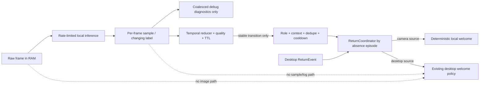

# Đặc tả Camera AI cho Alice

**Trạng thái:** Chủ dự án đã báo camera và phần mở rộng thử ổn, duyệt lời chào LLM và xác nhận bằng cử chỉ tay/đầu. Nhánh LLM camera có quota SQLite và client riêng; cấu hình máy chủ dự án đã bật, chưa chạy thử phần tích hợp mới trong phiên chỉnh sửa. Nhiều camera/vision LLM vẫn ngoài phạm vi.
**Phiên bản:** 0.8 · 2026-09-28 · tích hợp lời chào LLM có hạn mức
**Đối tượng đọc:** người sở hữu dự án, kỹ sư ứng dụng/camera, người rà soát riêng tư
**Tài liệu liên quan:** [Thiết kế kiến trúc](camera_ai_architecture.md), [Riêng tư và bảo mật](camera_ai_security_privacy.md), [Đề xuất kiến trúc IoT](iot-architecture-proposal.md)

**Thiết kế tích hợp hiện hành:** [Camera LLM integration](camera_llm_integration.md) ghi phạm vi, quota, payload, cancellation, fallback và cấu hình đã được chủ máy chọn ngày 2026-09-28.

> Presence, Face Auth v1, Emotion và Gesture đã được chủ máy thử trên webcam. Kết quả thử này xác nhận đường đi hoạt động cho cá nhân sử dụng, không phải chứng nhận độ chính xác, liveness hay an ninh. Các mục roadmap bên dưới chỉ ghi nhận thiết kế đã bàn luận; cần duyệt phạm vi và nghiệm thu riêng trước khi implement.

## 1. Tóm tắt

Alice mở một webcam local và có một capture pipeline dùng chung cho presence, Face Auth v1, Emotion, Gesture và debug preview. Panel CAMERA cho phép xem frame đang lấy cùng với trạng thái/provider/log. Chủ dự án đã thử hiện thực AI hiện tại; bảng thử và tải quan sát bên dưới ghi lại giới hạn bằng chứng. Frame không đi vào LLM hay MQTT. Chỉ presence được gửi qua IoT loopback API theo schema hiện có.

Camera được phát triển thành pipeline cục bộ có một nguồn capture dùng chung và các consumer riêng. Face Auth v1 chỉ hiển thị gợi ý khớp khuôn mặt chủ máy; hồ sơ chủ máy luôn hoạt động như trước, không có chọn/chuyển profile tự động hay xác minh danh tính. Emotion chỉ ghi ước lượng vào debug panel khi bật riêng. Gesture nhận thumbs-up và OK mặc định khi camera chạy. Dữ liệu video/ảnh không được lưu mặc định, gửi ra ngoài, hoặc đưa vào LLM.

## 2. Vấn đề và người dùng

### Vấn đề

Camera hiện chỉ cung cấp presence dựa trên khuôn mặt chính diện. Người phát triển chưa có đủ khả năng quan sát ảnh đầu vào và quyết định detector để chẩn đoán sai lệch. Các ý tưởng Face Auth, biểu cảm và gesture cần xử lý ảnh khác nhau, có tần suất khác nhau và mức nhạy cảm dữ liệu khác nhau; đặt tất cả vào `CameraService` hoặc một model duy nhất sẽ làm lifecycle, hiệu năng và quyền riêng tư khó quản lý.

### Nhóm người dùng

- **Chủ máy Alice:** bật/tắt camera và gợi ý khuôn mặt, đăng ký/xóa template; hồ sơ chủ máy hiện tại không phụ thuộc camera.
- **Người phát triển:** xem frame gần nhất, trạng thái thiết bị, detector, kết quả từng mẫu và lỗi phụ thuộc mà không cần ghi video hoặc gửi ảnh ra ngoài.
- **Các feature nội bộ:** nhận observation có timestamp, nguồn, confidence và hạn dùng; không trực tiếp mở webcam hoặc gọi model.

## 3. Mục tiêu và ngoài phạm vi

### Mục tiêu

1. Cho phép chẩn đoán camera/detector bằng preview cục bộ và log có thể đối chiếu.
2. Chỉ mở một capture device cho mỗi camera vật lý; nhiều consumer cùng dùng frame mới nhất.
3. Tách provider face, emotion và hand landmark khỏi giao diện, IoT, agent và chính sách nghiệp vụ.
4. Giữ hình ảnh và dữ liệu nhận diện trên máy Alice; không ghi hoặc gửi frame mặc định.
5. Bảo đảm lỗi một model không làm sập UI, voice agent, camera capture hoặc consumer khác.
6. Chỉ nhận hai gesture đã chốt, có debounce và trạng thái quan sát trong debug panel.

### Không thuộc phạm vi bản đầu

- Phát video trực tiếp lên cloud, MQTT, LLM hoặc dịch vụ phân tích ảnh ngoài.
- Ghi hình nền, lịch sử ảnh, nhận dạng khách lạ, theo dõi danh tính nhiều người hoặc tìm kiếm người trong lịch sử.
- Dùng biểu cảm để chẩn đoán tâm lý/sức khỏe, suy luận ý định, hoặc tự đổi persona/hành vi của Alice.
- Dùng gesture làm yêu cầu agent mới, gọi tool trực tiếp hoặc thực hiện lệnh IoT khi không có hành động đang chờ xác nhận. Khi có pending confirmation, gesture "đồng ý" đi cùng đường xác nhận hiện có và có thể hoàn tất hành động đã hỏi.
- Thay Windows sign-in, thay thế mật khẩu/PIN, hoặc bảo vệ hành động đặc quyền bằng camera.
- Thêm camera IP/RTSP trong giai đoạn đầu; kiến trúc chỉ giữ seam provider để mở rộng sau này.

## 4. Phạm vi theo giai đoạn

| Giai đoạn | Nội dung | Điều kiện vào | Kết quả cần có |
|---|---|---|---|
| 0 · Chẩn đoán | Tab CAMERA, preview có overlay, trạng thái/error, log mẫu detector; chỉ báo camera và pause/disable trên UI thường | Đã có webcam local và debug panel | Visual QA trên máy thật; preview chỉ tồn tại khi panel hiện; pause dừng capture |
| 1 · Nền pipeline | Capture dùng chung, latest-frame channel, observation contract, gửi presence bất đồng bộ | Giai đoạn 0 được kiểm tra | Presence hiện tại giữ hợp đồng; lỗi/restart có thể quan sát |
| 2 · Face/Auth v1 | Gợi ý khớp một profile chủ máy; enrollment/delete; không xác minh danh tính | Chọn model/weights có quyền dùng cá nhân, áp dụng lưu trữ template được bảo vệ và fallback | Chỉ gợi ý profile trong Alice, local-only; không bảo vệ tài sản/hành động |
| 3 · Biểu cảm | Provider biểu cảm khuôn mặt chạy riêng, mặc định tắt; kết quả chỉ ở debug panel | Model/checksum và ngưỡng tạm đã chọn; cần QA webcam, CPU/RAM và hiệu chỉnh ngưỡng | Output tên là `expression_estimate`, không phải sự thật cảm xúc; không đưa lên UI thường |
| 4 · Gesture | Hand landmarks và bộ phân loại thumbs-up/OK luôn bật cùng camera | Model/dependency đã cài; cần kiểm tra accidental trigger | Xác nhận pending action qua đường voice; thumbs-up còn là lời khen |

Face Auth v1 chỉ hiển thị gợi ý; mọi tính năng Face Auth bổ sung thuộc spec v2 riêng. Emotion là capability debug riêng đã có worker tùy chọn; gesture là worker độc lập và mặc định bật.

### Roadmap ý tưởng đã bàn luận (chưa triển khai)

| ID | Ý tưởng | Mức chốt hiện tại | Phạm vi thiết kế |
|---|---|---|---|
| CAM-FUT-01 | Phân biệt webcam tích hợp với camera ngoại vi | Đã chốt cần nhãn/metadata riêng; chưa chốt hỗ trợ nhiều thiết bị | Tách loại thiết bị vật lý khỏi vai trò/góc nhìn; chỉ camera gắn với máy trạm mới được cấp các capability tương tác cá nhân |
| CAM-FUT-02 | Nhận biết người dùng quay lại/ngồi trước máy | Đã đồng ý hướng nghiên cứu; chưa duyệt triển khai | Ước lượng `near/far/unknown` theo cấu hình từng camera, rồi phối hợp SALM và chống lặp; không cảnh báo bảo mật |
| CAM-FUT-03 | Gật/lắc đầu | Đã nêu ý tưởng; mapping hành động chưa chốt hoàn toàn | Nhận chuỗi chuyển động đầu theo thời gian, dùng như yes/no có điều kiện khi Alice đang đợi xác nhận |
| CAM-FUT-04 | Mở rộng gesture bàn tay | Chưa quyết định gesture | Giữ bộ phân loại theo allowlist; chỉ thêm cử chỉ sau khi chủ dự án định nghĩa rõ tư thế và tác động |
| CAM-FUT-05 | Ngăn camera làm phát sinh API call liên tục | Đã nối budget cho phạm vi lời chào được duyệt | Không gọi LLM từ frame/log/mẫu; Return qua episode dedupe, durable call budget và local fallback |

Các đề xuất này không thay đổi phạm vi các capability hiện tại. Đặc biệt Face Auth v1 không chuyển hồ sơ chủ máy, không xác thực danh tính và không cấp quyền; mọi mở rộng danh tính/an ninh thuộc Face Auth v2 với spec riêng. Cảnh báo bảo mật ở nơi công cộng là ngoài phạm vi hiện tại và không được kích hoạt bởi proximity/return.

## 5. User stories

- Là chủ máy, tôi muốn thấy camera đang chạy, tạm dừng được ngay và biết feature nào đang dùng camera để kiểm soát riêng tư.
- Là người phát triển, tôi muốn xem preview gần thời gian thực cùng bounding box và log detector để biết ảnh nào đang được xử lý.
- Là chủ máy, nếu bật gợi ý khuôn mặt, tôi muốn đăng ký/xóa template của mình và thấy “khớp/không khớp/không xác định” mà không làm đổi hồ sơ đang hoạt động.
- Là chủ máy, nếu bật biểu cảm, tôi muốn xem ước lượng biểu cảm và lỗi model trong debug panel mà không hiện chúng trên avatar, HUD, thông báo hay các bề mặt UI thường.
- Là chủ máy, tôi muốn giơ thumbs-up hoặc dấu OK để đồng ý với hành động Alice vừa hỏi; thumbs-up còn thể hiện lời khen. Gesture tự chạy khi camera đang bật.
- Là feature IoT, tôi muốn nhận presence có hạn dùng mà không phụ thuộc Face Auth, emotion hoặc gesture.

## 6. Yêu cầu chức năng

### P0 — Debug và ranh giới dữ liệu

**FR-001 · Trạng thái camera.** Panel phải hiển thị `disabled`, `starting`, `available`, `unavailable`, `paused`, `stopping`, `stopped` hoặc `error`, cùng camera index, room, thời điểm frame cuối và thông báo lỗi đã làm sạch.

**FR-002 · Preview.** Khi debug panel đang mở, hiển thị frame mới nhất đã thu nhỏ tối đa 640 px chiều ngang. Overlay detector phải phân biệt được với ảnh gốc. Preview là snapshot cập nhật, không phải video được lưu.

**FR-003 · Log nhận diện.** Log mẫu có timestamp, sequence/frame time, detector/provider và model version nếu có, số phát hiện, confidence nếu provider cung cấp, quyết định sau smoothing, độ trễ inference và trạng thái lỗi. Không ghi ảnh, face crop, embedding, tên đã enrol, access token hoặc nội dung nhạy cảm.

**FR-004 · Điều khiển preview.** Đóng/ẩn panel dừng encode preview và xóa tham chiếu frame ở service/UI. Mở lại panel mới cho phép tạo preview trở lại. Ẩn panel không dừng camera capture; camera state được điều khiển độc lập.

**FR-005 · Không làm nghẽn capture.** Preview, inference, HTTP/IoT reporting và cập nhật UI không được chặn vòng lặp đọc frame. Kênh frame dùng latest-only có giới hạn; frame cũ bị bỏ khi consumer chậm.

**FR-006 · Tương thích presence.** Detector Haar hiện tại chỉ thấy khuôn mặt chính diện; đặt tên output là `camera.face_presence_proxy`, không gọi là phát hiện người. Khi detector đang hoạt động, `present=false` nghĩa là detector không thấy mặt đủ điều kiện trong mẫu đó, không chứng minh phòng trống. Camera offline/pause/stale tạo trạng thái local `unknown/unavailable`; do API IoT hiện tại chỉ nhận boolean, adapter có thể gửi `false` để thu hồi presence dương cũ/fail closed. Gateway hiện chỉ cho auto-on khi có presence `true` còn hạn; `false` và event hết TTL đều chặn auto-on, không kích hoạt hành động dựa trên vắng mặt. Nếu thêm hành động dựa trên “không có người”, phải đổi hợp đồng sang trạng thái có phân biệt `present/absent/unknown` trước. Face Auth không thay thế điều kiện presence cho automation.

**FR-007 · Chỉ báo và điều khiển camera.** UI thường (ngoài debug panel) phải cho biết camera đang hoạt động/tạm dừng và có thao tác pause/disable dễ tìm. Pause dừng đọc frame, xóa preview hiện có, đánh dấu capability unavailable và không tự bật lại. Ẩn debug panel chỉ dừng preview, không phải tắt camera.

**FR-008 · Tắt webcam bằng giọng nói (2026-09-29).** Nhận “Alice tắt webcam”, “Alice tắt camera”, “Alice tạm dừng camera” sau wake-word/STT gate và gọi `CameraService.pause()`. Lệnh riêng chạy local, kể cả khi fast commands chung tắt. Trong câu ghép có vế độc lập nối bằng “và”/dấu phân cách, tách vế off, dừng camera local và giữ nguyên nội dung các vế còn lại cho luồng xử lý thông thường. Không tách câu có phủ định, điều kiện, trích dẫn hoặc thứ tự rõ ràng; Agent có tool `turn_off_webcam` riêng để xử lý các trường hợp đó. Tool không bật speech shortcut để tránh cắt phần việc còn lại của câu ghép. `kill_process` từ chối alias thiết bị camera/webcam trước bước hỏi xác nhận, kể cả đường đã confirmed. Pause giải phóng capture, xóa preview/vision state và hủy visual confirmation; không xóa pending action của Agent hoặc template enrollment. Tác động trong phiên; resume qua UI hiện có, restart theo `CAMERA_ENABLED`. Camera feature không tồn tại thì lệnh riêng báo webcam không được bật.

### P1 — Face Auth và biểu cảm

**FR-101 · Face Auth opt-in.** Gợi ý khớp profile chỉ chạy khi người dùng bật rõ ràng và có template enrollment hợp lệ. Mặc định tắt. Không enrollment thầm từ luồng webcam; kết quả không phải xác thực danh tính.

**FR-102 · Enrollment và xóa.** UI phải giải thích dữ liệu được tạo/lưu, yêu cầu người dùng xác nhận, cho phép hủy, xem trạng thái enrollment và xóa toàn bộ template. Chỉ lưu template trong kho local bảo vệ riêng theo user; không lưu ảnh enrollment/crop sau khi tạo template. “Tắt Face Auth” dừng inference và xóa suggestion hiện tại nhưng giữ template mã hóa để có thể bật lại; “Xóa khuôn mặt đã đăng ký” mới xóa template. Hai thao tác phải được phân biệt rõ trong UI.

**FR-103 · Fallback.** Camera unavailable, model lỗi, ánh sáng kém hoặc chất lượng không đủ phải trả `unknown`. Hồ sơ chủ máy đang hoạt động tiếp tục hoạt động bất kể kết quả camera; Face Auth v1 không được mở khóa OS, chứng minh danh tính, chuyển profile, hoặc cho phép hành động đặc quyền.

**FR-104 · Mục đích và liveness.** Face Auth v1 chỉ hiển thị gợi ý trong Alice; không bảo vệ tài sản/hành động, không mở khóa OS hoặc đổi profile. Phải đo chất lượng matching trên môi trường đích và công bố giới hạn. Liveness/challenge, kiểm tra photo/video/replay spoof và ngưỡng FAR/FRR là cổng bắt buộc nếu phạm vi tương lai bảo vệ tài sản/hành động; khi chưa có các điều kiện đó, kết quả chỉ là gợi ý, không phải xác thực an ninh.

**FR-105 · Ước lượng biểu cảm.** Feature biểu cảm phải có cờ bật/tắt riêng, mặc định tắt; thao tác và trạng thái của feature nếu có UI chỉ nằm trong debug panel. Kết quả nhãn/độ tin cậy, trạng thái `unknown` và lỗi model chỉ xuất hiện trong log chẩn đoán của debug panel. Không hiển thị nhãn, badge, thông báo, overlay hoặc thay đổi khuôn mặt/avatar trên bất kỳ UI thường nào của Alice; không phát lệnh `AssistantBus.emotion`. Không đưa kết quả vào persona, prompt, memory, care, IoT hoặc hành động; không đánh giá sức khỏe/tâm lý. Khi debug panel đóng, không có bề mặt hiển thị Emotion khác.

**FR-106 · Tách consumer.** Face Auth và emotion có cờ bật/tắt, chu kỳ inference, health, timeout và lỗi riêng. Tắt emotion không ảnh hưởng auth; lỗi auth không ảnh hưởng presence.

### P2 — Gesture

**Lớp nhận diện mở rộng (2026-09-30).** Geometry chung sinh đặc trưng 3D/2D cho hai nhãn xác nhận cũ và các pose tức thời tham khảo từ WonderSnap (`open`, `fist`, `peace`, `point`, `other`). Temporal tracker tạo pose ổn định, cạnh pinch và hướng vuốt trong tọa độ ảnh. Các đầu ra mới chỉ là chẩn đoán trong debug panel, không được coi là lệnh hay nối với LLM/OS. Bộ xác nhận `thumbs_up`/`ok` và điều kiện pending action không đổi. Double tap/click/scroll chưa được ánh xạ; cần định nghĩa chuỗi động tác, tăng nhịp lấy mẫu khi chế độ tương tác bật và thử false positive trước khi nối tác động.

**FR-201 · Mặc định hoạt động.** Hand landmark/gesture tự chạy khi camera đang hoạt động, không cần nút hoặc cử chỉ kích hoạt. Pause/stop camera là cách dừng inference; trạng thái và lỗi gesture hiện trong debug panel.

**FR-202 · Ánh xạ.** Chỉ nhận `thumbs_up` (bốn ngón nắm, ngón cái thẳng hướng lên) và `ok` (đầu ngón cái/trỏ tạo vòng, ba ngón còn lại duỗi). Cả hai tương đương câu xác nhận "đồng ý" nếu agent đã có hành động chờ xác nhận trước khi pose bắt đầu; dùng cùng `agent.confirm_pending("yes")`. Pose giữ sẵn trước khi Alice hỏi không thể xác nhận câu hỏi mới. Không có pending thì OK không hành động. Thumbs-up còn cập nhật tâm trạng phản hồi lời khen trong phiên. Không biến gesture thành câu lệnh mới hoặc gọi tool trực tiếp.

**FR-203 · Debounce.** Cần một bàn tay rõ, giữ cùng pose tối thiểu 0,7 giây và ít nhất bốn mẫu; chỉ phát một lần cho mỗi lần giữ. Phải hạ tay/ra khỏi pose tối thiểu 0,4 giây mới nhận lần tiếp theo, có cooldown 1,5 giây. Nhiều tay, không rõ pose, mất frame hoặc camera pause trả `unknown` và không xác nhận.

### P3 — Camera source, proximity và nhận biết quay lại (đề xuất)

**FR-301 · Nhãn nguồn và vai trò độc lập.** Source hiện tại trước hết chỉ cần descriptor tối thiểu: ID local, nhãn hiển thị, role `workstation_facing` và allowlist capability của webcam này; chưa xây full multi-camera registry. Khi có camera thứ hai mới mở rộng `device_kind`, `transport` và allowlist per source. `device_kind` (`integrated_webcam`, `usb_camera`, `ip_camera`, `unknown`) mô tả phần cứng; `role` (`workstation_facing`, `room_observation`, `unknown`) mô tả góc nhìn. Không suy ra role từ loại USB. `cv2.VideoCapture` hiện chọn bằng index số, chưa cung cấp ID phần cứng ổn định trong ứng dụng; không được tuyên bố source đã được ràng buộc bền vững hoặc tự phát hiện loại camera khi chưa có cơ chế Windows phù hợp. UI dùng nhãn như “Webcam laptop” và “Camera ngoại vi — bàn làm việc/phòng”.

**FR-302 · Capability theo role.** Face Auth suggestion, Emotion, Hand Gesture, Head Gesture và Workstation Return chỉ được gắn với source có role `workstation_facing` và backend local được hỗ trợ. `room_observation` mặc định chỉ có thể cung cấp presence thô nếu một phạm vi riêng cho phép; không chạy Face Auth/Emotion/Gesture/return trên nguồn đó. IP/RTSP camera chưa được hỗ trợ và cần thiết kế riêng về credentials, transport, mạng, reconnect và retention trước khi thêm.

**FR-303 · Khoảng cách tương đối, không phải mét.** Detector phát `near`, `far` hoặc `unknown` tương đối với vùng ngồi đã hiệu chỉnh cho đúng camera/độ phân giải/góc lắp. Tín hiệu đầu tiên là kích thước mặt chuẩn hóa theo chiều cao ảnh, kết hợp ROI, chất lượng và ổn định thời gian; ưu tiên tái sử dụng bbox của worker presence hiện có thay vì chạy YuNet lần nữa. Không phát `distance_m`. `unknown` là bắt buộc khi chưa hiệu chỉnh, nhiều mặt, nghiêng/che khuất, thay đổi camera/zoom/độ phân giải hoặc chất lượng suy luận thấp. Thay đổi cấu hình có thể tự vô hiệu hiệu chỉnh; di chuyển vật lý camera không thể được xác nhận chắc chắn chỉ từ metadata, nên phải có hiệu chỉnh lại thủ công hoặc gắn cờ nghi ngờ drift và trả `unknown`.

**FR-304 · Chống nhấp nháy proximity.** `near`/`far` chỉ đổi sau dwell, số mẫu hợp lệ tối thiểu và hysteresis với ngưỡng vào/ra khác nhau. `band=unknown` khi không thấy mặt; trường `visibility=no_face` có thể được ghi riêng nếu camera khỏe và frame đủ chất lượng, nhưng một mẫu âm không chứng minh người đã rời bàn. TTL phải hiệu chỉnh theo cadence/p95 sample age đo trên máy đích, không cố định độc lập tốc độ inference. Nhòe, lỗi camera, multiple faces, pause/reconnect và gap frame reset candidate; chuyển `unknown → near` tự nó không phải return.

**FR-305 · Workstation Return.** Camera cung cấp bằng chứng local, không xác định danh tính bằng Face Auth v1. Episode riêng cần prior `near` → `far`/healthy `no_face` đủ min-absence → stable `near` mới; unknown/pause/lỗi/reconnect/startup không tạo absence. Coordinator hợp nhất với desktop Return, một lần thử chào mỗi episode, đọc SALM session state làm veto và không ghi đè presence/clock/care/IoT. Camera unavailable giữ desktop behavior. `shadow` chỉ ghi debug; `local` dùng câu có sẵn; mode `llm` đã được owner duyệt và chỉ tạo wording qua quota/payload/freshness gates trong FR-503–504.

**FR-306 · Không suy ra người dùng từ người đi ngang.** `far`, ngoài ROI workstation, camera phòng, unknown hoặc chất lượng thấp không tạo return. Candidate camera cần một absence episode trước đó, vùng ngồi, dwell, quality và session/display hợp lệ; SALM `AWAY` do idle đơn lẻ không đủ chứng minh vắng mặt, còn SALM `PRESENT` do video đang phát không được chặn một lần camera quay lại thực sự. Có thể bổ sung tín hiệu bàn phím/session để tăng độ chắc chắn, nhưng bắt buộc tín hiệu đó sẽ biến feature thành “xác nhận sau khi dùng máy” thay vì “nhận ra khi vừa ngồi xuống”. False positive chỉ được phép dẫn tới lời chào local; không có cảnh báo, quyền hoặc hành động bảo mật.

### P4 — Cử chỉ đầu và gesture tương lai (đề xuất)

**FR-401 · Head Gesture yes/no.** Head tracker chỉ chạy trên `workstation_facing`. Ước lượng yaw/pitch tương đối từ chuỗi landmark/pose local, chuẩn hóa với tư thế neutral của phiên; phân biệt chuỗi gật (pitch lên-xuống) và lắc (yaw trái-phải) bằng dwell, biên độ tối thiểu, chu kỳ và chất lượng. Không chốt ngưỡng góc tuyệt đối trước khi benchmark trên webcam. Nhòe, mất landmark, đổi sáng, pose ngoài trục hoặc chuyển động không trọn chu kỳ phải là `unknown` và reset candidate, không phát yes/no.

**FR-402 · Head Gesture chỉ trả lời pending confirmation.** Gật đầu map `yes`, lắc đầu map `no` chỉ khi một câu hỏi xác nhận đã tồn tại trước lúc chuỗi cử chỉ bắt đầu. Head và hand dùng chung một visual-confirmation arbiter trước đường `agent.confirm_pending("yes"/"no")`; arbiter kiểm pending object/ID còn hiện hành, thời điểm bắt đầu pose, TTL và consumed-once dưới cùng lock. Nếu hai modality đưa yes/no trái nhau trong cửa sổ ngắn trước khi thực thi, bỏ cả hai và yêu cầu xác nhận bằng giọng nói/nút; không chọn một kết quả theo thứ tự callback may rủi. Pose bắt đầu trước câu hỏi không hợp lệ. Ngoài pending confirmation, head gesture chỉ là metadata chẩn đoán trong debug panel, không tạo lệnh mới, không gọi tool và không sửa trạng thái agent.

**FR-403 · Cho phép mở rộng cử chỉ có kiểm soát.** Gesture mới phải khai báo pose allowlist, đặc điểm phân loại, điều kiện giữ/thả/cooldown, ngữ cảnh được phép, tác động chính xác, fallback/false-positive behavior và tập kiểm tra. Không thêm gesture do classifier tự suy rộng; nhãn chưa khai báo luôn `unknown`. Việc chọn gesture và mapping là quyết định còn mở của chủ dự án.

### P5 — Tách mẫu camera khỏi sự kiện SALM và giới hạn API (bắt buộc cho mọi tích hợp)

**FR-501 · Mẫu không phải event.** Mọi frame, output inference, confidence/label thay đổi và debug log là telemetry local. Adapter chỉ phát typed domain event khi một state machine chấp nhận transition ổn định. Không có đường `frame → LLM`, `camera log → LLM`, `inference sample → Agent`, hay đưa image/embedding/landmarks vào prompt hoặc memory.

**FR-502 · Khử lặp và tiêu thụ một lần.** Domain event có `event_id`, camera source, first/last frame sequence, captured/inferred time, expiry và phiên bản policy. Consumer ghi nhận event ID đã tiêu thụ trong phiên; event hết hạn, duplicate, cùng transition đang xử lý hoặc gắn với pending action khác bị bỏ. Riêng lời chào Return cần thêm `absence_episode_id` do coordinator gán; desktop `ReturnEvent` hiện chưa có ID này, nên coordinator phải quan sát transition SALM cùng lúc và tương quan các khoảng vắng bằng monotonic clock, thứ tự transition và cửa sổ thời gian hiệu chỉnh. Không suy khoảng monotonic từ wall-time `ReturnEvent.at`. Hai event ID khác nhau vẫn có thể mô tả một lượt quay lại. Một episode chỉ được *thử* chào một lần trong phiên process; nếu gate âm thanh từ chối, không phát thêm API call để thử lại. Không phát event mới chỉ vì detector quay lại từ `unknown` sang cùng kết quả trong thời gian cooldown.

**FR-503 · Ranh giới LLM theo nguồn.** Camera Return chỉ tạo `WelcomeRequest(source=camera, absence_episode_id=...)` ở coordinator sau absence, proximity, freshness, source role, debounce, dedupe, cooldown và policy. `local` dùng câu có sẵn; `llm` dùng `CameraReturnWelcome` với client và budget riêng, không dùng client xoay model của desktop. LLM chỉ nhận contract viết lời chào, persona, cách xưng hô, loại `return` và style; không nhận camera observation. Desktop giữ policy hiện hữu. Emotion, face-match, head/hand sample và log không kích hoạt LLM.

**FR-504 · Hạn mức lời chào camera.** Sau quyết định ngày 2026-09-28, mode `llm` được phép với quota riêng: mặc định 1 attempt/15 phút, tối đa 3 trong cửa sổ trượt 1 giờ và 12 trong 24 giờ. `CameraCallBudget` reserve/commit SQLite ngay trước provider call; timeout/lỗi không hoàn quota; bộ đếm tồn tại qua restart. Config chỉ siết quota, không tăng trần. Không retry/xoay model, một in-flight trong process, output budget 256 token mặc định và deadline 5 giây. Không mở/ghi được budget hoặc clock lùi thì dùng local. Đây là giới hạn camera welcome, không phải mức chi tiêu bằng tiền hoặc quota chung toàn Alice. Xem [thiết kế chi tiết](camera_llm_integration.md).

**FR-505 · Budget và log không phụ thuộc nhau.** Log bị coalesce không được làm mất transition hợp lệ. `AssistantBus._debug_q` đã được giới hạn tại bus, không chỉ widget panel. Sample log camera hiện được giảm tần suất khoảng một dòng/giây theo loại; vẫn cần đo volume trên máy đích và bổ sung summary min/median/max theo chu kỳ. Khi queue đầy, bỏ sample cũ, giữ error và state transition ưu tiên, tăng dropped counter; producer không được block capture. Không ghi raw image/landmark/identity. Camera result chẩn đoán mới vẫn chỉ đi qua debug panel; không gửi console/file/log analytics hoặc LLM.

**FR-506 · Không tích lũy backlog.** Dùng latest-frame capacity 1, coalesce status theo camera/module và tối đa một pending accepted event cho mỗi event kind/source. Khi consumer bận, thay thế sample cũ; không chạy inference catch-up. Backpressure/queue full làm bỏ sample và tăng counter chẩn đoán, không tăng số lần gọi API.

**FR-507 · Một episode, một lần thử lời chào; một pending, một xác nhận.** Camera/desktop return thuộc cùng absence episode chỉ có thể thử kích hoạt tối đa một greeting. Accepted gesture/head event chỉ có thể tiêu thụ pending confirmation đang tồn tại qua arbiter chung; xác nhận thành công làm pending action đóng, duplicate event không thể lặp lại action hoặc lời nói phản hồi. Nếu head/hand cùng lúc đưa kết quả trái nhau, không xác nhận. Không tái gửi event khi model/worker restart; reset state về `unknown` và đợi transition mới.

## 7. Yêu cầu kỹ thuật và chất lượng

Các mục sau là mục tiêu ban đầu để đo trên máy Alice, không phải cam kết hiệu năng trước benchmark:

- **Độ trễ preview:** p95 ≤ 1,5 giây từ lúc camera trả frame tới lúc panel hiển thị khi panel mở.
- **Độ trễ gesture:** inference từng frame mục tiêu p95 ≤ 300 ms; event chấp nhận phát sau thời gian giữ pose 0,7 giây, cần benchmark trên máy đích.
- **Giới hạn buffer:** tối đa một frame mới nhất cho mỗi consumer cùng process; không có queue video không giới hạn.
- **Độ phân giải CV:** provider nhận kích thước tối đa cấu hình được; mặc định không lớn hơn 640 px chiều ngang cho preview/presence. Auth có thể yêu cầu crop/scale riêng và chỉ trong worker.
- **Độ sẵn sàng:** thiếu model/dependency phải tắt riêng capability đó và báo health, không crash Alice. OpenCV presence cũ vẫn chạy nếu model AI tùy chọn không cài.
- **Tách UI:** không gọi Tkinter từ camera thread, worker thread hoặc process.
- **Tách domain:** model không gọi IoT, agent, tool registry hoặc actuator trực tiếp. Policy/adapter đổi observation thành sự kiện được kiểm soát.
- **Phần cứng baseline:** laptop AMD Ryzen 5 5500U, AMD Radeon Graphics tích hợp, RAM 16 GB. Thiết kế không yêu cầu GPU rời hoặc CUDA; phải đo đường CPU trên cấu hình này. Tăng tốc qua iGPU chỉ là tối ưu tùy chọn sau khi xác minh provider/runtime cụ thể.
- **Hỗ trợ hệ điều hành:** Windows desktop hiện tại là baseline; package/model worker phải tương thích Python/runtime đóng gói của dự án trước khi thêm vào dependencies bắt buộc.
- **Đóng gói:** model weights không tải âm thầm khi khởi động; nguồn, checksum, version, license, provider/backend và kích thước phải được khai báo.
- **Timeout native inference:** timeout ở thread chỉ đánh dấu kết quả cũ/degraded; không thể cưỡng bức dừng lời gọi native đang treo. Nếu cần hủy/restart cứng trước khi bật rộng rãi, provider đó phải chạy trong process cô lập.

### Mục tiêu chất lượng matching profile

Chốt phương pháp đánh giá matching trước khi phát hành rộng và ghi rõ kết quả chỉ là gợi ý, không xác minh danh tính hoặc đổi hồ sơ. Nếu sau này muốn dùng camera để bảo vệ tài sản/hành động, phải có threat model, kiểm thử photo/video/replay, liveness/challenge phù hợp và ngưỡng FAR/FRR được phê duyệt như cổng phát hành riêng. Không tuyên bố “xác thực an toàn” từ demo webcam hoặc accuracy trung bình của benchmark công khai.

### Quan sát thực tế trên máy chủ dự án · 2026-09-26

Năm cặp log dưới đây do chủ dự án ghi lại ở các điều kiện có **chính chủ máy** trước camera. Mỗi dòng là một mẫu Face Auth và một mẫu presence gần thời điểm đó; sequence và thời điểm của hai mẫu khác nhau. Đây là kiểm tra hoạt động ban đầu, chưa phải benchmark hoặc phép đo tỉ lệ nhận diện.

| Điều kiện | Face Auth | Score | Latency Face Auth | Presence gần thời điểm đó | Latency presence |
|---|---|---:|---:|---|---:|
| Bình thường | `matched` | 0.851 | 24 ms | 1 mặt, 3/3 phiếu dương, `present=true` | 15 ms |
| Mặt nghiêng | `matched` | 0.740 | 39 ms | 1 mặt, 3/3 phiếu dương, `present=true` | 16 ms |
| Đeo kính | `matched` | 0.790 | 23 ms | 1 mặt, 3/3 phiếu dương, `present=true` | 15 ms |
| Ánh sáng yếu | `matched` | 0.623 | 22 ms | 0 mặt ở mẫu này, 1/3 phiếu dương, `present=true` do trạng thái được giữ tạm | 15 ms |
| Ánh sáng yếu và đeo kính | `matched` | 0.622 | 22 ms | 1 mặt, 3/3 phiếu dương, `present=true` | 16 ms |

`present=true` khi `face_count=0` không có nghĩa detector thấy mặt ở frame đó: presence dùng cửa sổ phiếu và giữ tối đa 5 giây từ lần gần nhất thấy mặt. Debug UI/log phải hiển thị riêng trạng thái `held` và kết quả phát hiện của mẫu hiện tại. Khoảng score 0.622–0.851 và latency 22–39 ms/15–16 ms chỉ mô tả các mẫu được chọn, không phải min/max hay p95 của phiên chạy.

Chủ dự án báo mức sử dụng **toàn bộ Alice** trên laptop đích:

| Cấu hình | CPU quan sát | RAM quan sát |
|---|---:|---:|
| Camera tắt | 0,8–1% | 1.200–1.300 MB |
| Camera bật, Face Auth tắt | 4,8–6,5% | 1.200–1.300 MB |
| Camera và Face Auth bật | 9,1–15% | 1.200–1.300 MB |

Các khoảng CPU cho thấy camera và Face Auth cùng làm tăng tải, nhưng không phải phép đo ghép cặp cùng thời điểm; chưa có thời lượng, tải nền hay chuỗi thời gian để tính chính xác phần tăng thêm, mức đỉnh hoặc độ ổn định lâu dài. RAM không thay đổi rõ trong độ phân giải của phép đo này. Số liệu hiện tại chưa tạo lý do chuyển worker sang process riêng.

Chủ dự án cũng thử ảnh **một người khác hiển thị trên điện thoại**. Khi ảnh ở khung riêng, Face Auth trả `not_matched`, score 0,061, latency 26 ms; presence thấy 1 mặt, 2/3 phiếu dương, latency 16 ms. Đây là một mẫu âm bằng ảnh trên màn hình, không phải người thật trước webcam và không đủ để ước lượng false match rate. Khi ảnh và chủ máy cùng khung, Face Auth log `matched` score 0,882 tại sequence 5171 rồi `unknown` tại sequence 5178; presence thấy 2 mặt tại sequence 5191. Các log ở ba frame khác nhau, nên không thể khẳng định Face Auth đã nhận diện hai mặt trong frame `matched`. Pipeline chỉ đưa gợi ý khi Face Auth thấy đúng một mặt đủ chất lượng; khi nhiều/không có mặt hoặc ảnh kém, gợi ý thành `unknown` và xóa phiếu khớp cũ. Log mới ghi `quality` và phiếu matching để phân biệt các nguyên nhân đó.

Chưa có bộ mẫu người lạ đa dạng hoặc thống kê false match/miss, cũng chưa đánh giá ảnh/video giả mạo như một tính năng an ninh. Không yêu cầu thêm người thử để tiếp tục Face Auth v1 dạng gợi ý. Giữ ngưỡng gợi ý hiện tại; chỉ hiệu chỉnh sau khi có bộ mẫu dương và âm phù hợp.

## 8. Dữ liệu và hợp đồng

### Luồng dữ liệu

```text
Webcam → Capture owner → latest-frame channels → vision providers
                                          ├→ diagnostics preview (chỉ khi panel mở)
                                          ├→ presence observation → IoT loopback API
                                          ├→ profile-match suggestion → local UI
                                          ├→ expression estimate → debug panel only (opt-in)
                                          └→ hand gesture → pending confirmation / lời khen
```

### Observation tối thiểu

Observation phải có `event_id`, `kind`, `camera_id`, `provider_id`, `provider_version`, `frame_sequence`, `captured_at`, `inferred_at`, `expires_at`, `status` và confidence nếu có ý nghĩa. Payload theo từng loại được giới hạn; payload chung không có bytes ảnh, đường dẫn ảnh hoặc embedding.

| Loại | Payload cho phép | Consumer |
|---|---|---|
| `camera.face_presence_proxy` | `present`, `confidence`, `room_id`, TTL; legacy Haar chỉ thấy mặt | IoT adapter; presence UI |
| `person.presence` | `present`, confidence, room_id, TTL; chỉ khi có detector người thật | UI/policy local; IoT chỉ sau quyết định schema riêng |
| `face.profile_match_suggestion` | `matched/not_matched/unknown`, local profile ID chỉ để gợi ý khi opt-in, confidence band | UI local; người dùng xác nhận/chọn thủ công |
| `face.expression_estimate` | label allowlist, confidence band, TTL; không chứa crop/ảnh | Chỉ adapter log debug panel khi opt-in; không chuyển sang UI thường, agent hoặc IoT |
| `hand.gesture` | `thumbs_up`/`ok`, hand count, trạng thái, frame sequence | Adapter xác nhận pending action; debug panel |
| `camera.health` | state, error code, last frame time, latency | debug panel |

Không đẩy profile-match result, emotion hay hand gesture vào IoT Gateway. Không có API nhận raw frame từ LLM trong phạm vi spec này.

## 9. Thành công và nghiệm thu

### Chỉ số

- Panel cho biết chính xác camera state trong kịch bản mở được, bị ứng dụng khác giữ, mất kết nối, thiếu OpenCV/model, đọc frame thất bại và app dừng.
- Khi panel hiện, preview cập nhật và khung detector trùng với kết quả log trên cùng frame/sequence.
- UI thường luôn hiện camera state và pause/disable; pause dừng capture/đọc frame và không tự resume.
- Khi panel ẩn, preview không được encode thêm và snapshot trong memory bị xóa; camera vẫn có thể chạy. Mở lại tiếp tục preview nếu camera đang bật.
- Thử tải cho thấy UI/voice loop vẫn phản hồi khi inference worker chậm hoặc chết; consumer khác không bị chặn.
- Presence sự kiện cũ hết TTL và không thể kích hoạt automation; lỗi auth/emotion/gesture không làm thay đổi policy IoT.
- Emotion chỉ có log trong debug panel; avatar, HUD, notification, voice, persona và các UI thường không nhận nhãn hay trạng thái suy ra từ model. Tắt Emotion dừng inference và xóa estimate tạm trong RAM.
- Gợi ý khuôn mặt phải có phương pháp kiểm tra chất lượng matching và giới hạn được công bố. FAR/FRR được duyệt, đo cùng liveness/spoof review trước khi bất kỳ use case bảo vệ tài sản nào được mở.
- Gesture chỉ nghiệm thu sau khi test accidental trigger, giữ pose, chuyển pose nhanh, nhiều người trong khung và camera mất frame.

### Checklist giai đoạn 0

- [ ] `--debug-panel` và `DEBUG_PANEL_ENABLED=true` mở tab CAMERA.
- [ ] Panel cho biết camera disabled/unavailable/running và thông báo lỗi phù hợp.
- [ ] UI thường có chỉ báo camera cùng pause/disable; pause dừng việc đọc webcam thật và không tự resume.
- [ ] Preview có kích thước giới hạn, hình đúng màu và overlay khuôn mặt khớp log.
- [ ] Log chứa metadata nhận diện, không chứa ảnh/crop/embedding.
- [ ] Ẩn panel xóa preview và dừng encode nhưng không giả làm camera-off; F12 hiện lại tiếp tục preview nếu camera đang bật.
- [ ] Camera lỗi không làm crash cửa sổ hoặc cản voice/agent.
- [ ] Kiểm tra trên webcam laptop thật và xác nhận latency/resource usage.

## 10. Rủi ro, phụ thuộc, câu hỏi mở

### Rủi ro/giảm thiểu

- **False match/miss:** gợi ý không làm đổi hồ sơ/hành động và phải có giới hạn công bố; liveness/FAR/FRR là cổng nếu phạm vi sau này bảo vệ tài sản/hành động.
- **License model:** mã InsightFace và model pretrained có điều khoản khác nhau; xác minh model cụ thể trước khi đưa vào package.
- **Tải CPU/RAM:** worker chạy theo tần suất riêng; bật profiling, latest-only buffer và tự hạ tần suất nếu trễ.
- **Accidental gesture:** một tay, pose rõ, thời gian giữ, chống lặp, cooldown và chỉ xác nhận hành động đã chờ. Gesture mặc định chạy nên cần thử tình huống ảnh/video/bàn tay người khác trong khung.
- **Cài đặt phức tạp:** vision backends là optional extras; không tăng gánh cài đặt của người dùng không bật camera AI.
- **Định nghĩa cảm xúc:** chỉ ghi nhận biểu cảm quan sát được, không khẳng định trạng thái tâm lý.

### Đã chốt theo phản hồi của chủ dự án

1. **Face Auth v1 chỉ hiển thị gợi ý.** Chủ dự án xác nhận hồ sơ chủ máy luôn hoạt động như hiện tại; kết quả model không đổi profile, quyền, prompt, memory hay action. Không xác minh danh tính, mở khóa hoặc thực hiện protected action. Các tính năng khác thuộc Face Auth v2 riêng.
2. **Cho phép lưu template.** Đã triển khai ciphertext dưới `%LOCALAPPDATA%/Alice/camera`, Windows DPAPI `CurrentUser` và ACL chỉ SID hiện tại; không lưu ảnh nguồn. Khi không giải mã được thì dừng matching và yêu cầu enrol lại; không fallback plaintext. DPAPI không ngăn ứng dụng/malware chạy dưới cùng user đọc dữ liệu sau giải mã.
3. **Một chủ máy/profile trong v1.** Không hỗ trợ nhiều người enrol; khả năng đăng ký nhiều profile để dành cho Face Auth v2.
4. **Chỉ dùng cá nhân, không thương mại.** Vẫn phải xác minh điều khoản của đúng bộ weights/model; nhãn “phi thương mại/nghiên cứu” không tự động chứng minh mọi kiểu sử dụng cá nhân đều được cấp quyền.
5. **Máy đích:** AMD Ryzen 5 5500U, AMD Radeon Graphics tích hợp, RAM 16 GB. Đường CPU là baseline; không yêu cầu CUDA/GPU rời. Đo latency/RAM trên laptop này trước khi chọn model/backend.
6. **Emotion chỉ dành cho debug panel.** Chủ dự án xác nhận không hiển thị kết quả Emotion trên UI thường của Alice dưới bất kỳ hình thức nào. Mọi log kết quả/trạng thái/lỗi của module này chỉ ở debug panel; không tác động avatar hoặc hành vi. Triển khai đầu tiên dùng EmotiEffLib `enet_b0_8_best_afew.onnx` trên CPU, tối đa khoảng 1 mẫu/giây, 8 nhãn biểu cảm và ngưỡng confidence tạm `0,50`; dưới ngưỡng hoặc không có đúng một mặt đủ rõ trả `unknown`. Ngưỡng này chưa được hiệu chỉnh bằng webcam thật và không phải độ chắc chắn về cảm xúc nội tâm.

### Đã chốt Gesture

7. **Hai cử chỉ và tác động.** Thumbs-up là bàn tay nắm với ngón cái chĩa thẳng lên; OK là đầu ngón cái và trỏ chạm thành vòng, ba ngón còn lại duỗi. Cả hai là "đồng ý" cho pending confirmation; thumbs-up đồng thời là lời khen cho hành động/quyết định của Alice. Chưa dùng gesture cho yêu cầu mới.
8. **Kích hoạt.** Gesture mặc định luôn chạy khi camera chạy; không có mode, nút hay cử chỉ kích hoạt. Pause camera chặn xử lý. Model/dependency được cài riêng; thiếu chúng chỉ làm worker gesture unavailable.

### Câu hỏi có thể giải quyết trong thiết kế/benchmark

- Vị trí/cách thể hiện chỉ báo camera và nút pause trên UI thường cần chốt trong thiết kế giao diện; sự hiện diện của chỉ báo và điều khiển pause là yêu cầu P0.
- Worker inference nặng có cần tiến trình riêng trên máy thực tế không? Quyết định sau khi đo tải và kiểm tra độ ổn định packaging.
- Model nào đạt latency/quality tốt nhất trong các model có quyền dùng? Chọn sau khi xác minh giấy phép và benchmark, không hard-code tên model vào contract.

## 11. Điều kiện bắt đầu code các giai đoạn AI

- Giai đoạn 0 được visual-QA trên webcam thật.
- Spec và architecture được chủ dự án chấp nhận; các câu hỏi “chặn phạm vi auth” được trả lời trước Face Auth.
- Library/model version và license đã được ghi lại; model weights được pin và checksum kiểm tra.
- Data-flow/privacy checklist và event schema được duyệt trước khi code lưu bất kỳ template sinh trắc nào.
- Mỗi giai đoạn có cờ cấu hình độc lập và có thể tắt/rollback mà không làm hỏng presence hiện tại.

## 12. Thiết kế chi tiết phần mở rộng đã bàn luận

Phần này ghi thiết kế và lịch sử rollout. Chủ máy đã báo thử nghiệm camera ổn, duyệt lời chào LLM và pending confirmation tay/đầu ngày 2026-09-28. Cấu hình máy này đã bật phạm vi đó; phần tích hợp LLM mới chưa được chạy thử trong phiên chỉnh sửa. Các gate benchmark/QA vẫn là hướng kiểm chứng, không phải kết quả đã đo. Sơ đồ nền nằm trong [kiến trúc](camera_ai_architecture.md), phạm vi tích hợp hiện hành ở [integration design](camera_llm_integration.md).

### 12.1 Metadata thiết bị và chính sách capability

Lát cắt đầu chỉ thêm descriptor cho một webcam hiện tại; registry nhiều camera chỉ làm khi có nguồn thứ hai. Record tối thiểu không chứa frame:

```text
CameraDescriptor(
  camera_id, display_name,
  device_kind,       # integrated_webcam | usb_camera | ip_camera | unknown; optional ban đầu
  role,              # workstation_facing | room_observation | unknown
  transport,         # local; network_future chưa hỗ trợ
  capabilities,      # explicit allowlist
  calibration_id,
  enabled
)
```

- `device_kind` trả lời “đây là webcam tích hợp, USB hay camera mạng”; `role` trả lời “camera nhìn người ngồi trước máy hay quan sát một không gian”. Hai metadata độc lập.
- `camera_id` là ID cấu hình local ổn định do ứng dụng quản lý, **không phải** định danh phần cứng được xác minh. `cv2.VideoCapture(index)` hiện chỉ có index số; khi chưa có API enumerate thiết bị Windows và binding phần cứng, index đổi có thể trỏ nhầm camera. Không log serial phần cứng nếu không cần.
- `display_name` là nhãn dễ đọc trong CAMERA panel. Không tự tuyên bố biết chắc `device_kind` từ index. Khi phát hiện cấu hình nguồn không còn hợp lệ thì đặt `unknown/unavailable`; việc phát hiện tráo index cần cơ chế binding riêng trước khi hỗ trợ nhiều nguồn.
- Tách cấu hình nguồn camera khỏi `IOT_CAMERA_ROOM_ID`: nhãn/vai trò của webcam trước máy không được suy từ phòng IoT. Không làm thay đổi schema presence IoT hiện hữu trong lát cắt metadata.
- Capability Router kiểm role và allowlist trước khi mở worker. Hiện `workstation_facing` local mới đủ điều kiện Face Auth, Emotion, Gesture và proximity hỗ trợ SALM. `room_observation` không được dùng nhận diện chủ máy hoặc tương tác Agent.
- Camera tích hợp/USB local là target gần; IP/RTSP camera, mạng credentials, nhiều source đang chạy đồng thời và quyền chọn camera đều ngoài phạm vi runtime hiện tại.

### 12.2 Ước lượng vùng gần/xa

Mục tiêu là loại bớt tín hiệu từ người/cảnh ở xa khỏi chức năng “người đang quay lại bàn”, không đo khoảng cách chính xác và không tuyên bố vùng an toàn.

**Contract:**

```json
{
  "kind": "camera.workstation_proximity",
  "camera_id": "workstation-webcam",
  "band": "near | far | unknown",
  "quality": "good | degraded | insufficient",
  "stable_for_ms": 1200,
  "valid_samples": 4,
  "visibility": "single_face | no_face | multiple_faces | degraded",
  "expires_at": "..."
}
```

Không có số mét, bounding box thô, ảnh hoặc face embedding trong event. Ngưỡng dựa vào face-size ratio (ví dụ chiều cao mặt/chiều cao frame) đã chuẩn hóa theo camera, có thể bổ sung ROI và chất lượng landmark. Không chuyển ratio thành mét.

**Calibration flow đề xuất:** chủ máy ngồi ở vị trí dùng laptop bình thường; lấy một số mẫu local tạm thời; tính baseline robust (median + spread) trong RAM; lưu cấu hình nhỏ chứa ratio/ngưỡng và version model/camera/độ phân giải; bỏ frame mẫu ngay. Cho phép calibration thủ công lại từ panel. Cấu hình/độ phân giải/zoom/model đổi có thể tự invalid calibration; **camera bị di chuyển vật lý không thể phát hiện chắc chắn** từ metadata, cần người dùng hiệu chỉnh lại hoặc phát hiện drift rồi tạm trả `unknown`. Không lưu ảnh calibration.

**Temporal policy đề xuất:** vào `near` sau dwell *và* số mẫu hợp lệ tối thiểu, chất lượng tốt, một mặt đủ lớn trong workstation ROI; thoát `near` bằng ngưỡng thấp hơn để có hysteresis. TTL và các mốc dwell phải đặt sau khi đo p95 sample age/cadence toàn hệ thống; 1,2 giây và 1 giây TTL chỉ là giá trị phác thảo, ở cadence 2 Hz có rất ít mẫu để quyết định. Khi nhiều mặt, không chọn mặt theo danh tính; trả `unknown` cho tác vụ return. `no_face` là visibility observation riêng khi camera khỏe và frame tốt, không tự đồng nghĩa người vắng mặt.

### 12.3 Workstation Return tích hợp SALM

SALM hiện có `ReturnWelcomeTracker`: absence `AWAY`/`SUSPENDED`, tối thiểu 120 giây vắng và cooldown 300 giây trước khi phát `ReturnEvent`. `Presence.PRESENT` có thể do tương tác gần đây **hoặc foreground media**; `AWAY` có thể do idle dù người vẫn đọc màn hình. Vì vậy camera Return không được dựa duy nhất vào transition desktop này và không thay thế tracker desktop.

**Luồng đề xuất:**

```text
frame sample
  → workstation-facing source + fresh frame
  → proximity estimator (near/far/unknown) + dwell/hysteresis
  → camera absence episode: prior near → sustained trustworthy far/no_face → stable near
  → local WorkstationNearCandidate (event ID, episode ID, TTL)
  → ReturnCoordinator merges candidate with optional desktop ReturnEvent by episode
  → source-aware WelcomeRequest; camera source uses local or budgeted text-only LLM welcome
```

Camera candidate không phải `ReturnEvent` hay bằng chứng danh tính. Episode camera chỉ bắt đầu sau `near` từng được quan sát, rồi `far` hoặc `no_face` đáng tin kéo dài ít nhất thời gian vắng đã hiệu chỉnh; blur, mất frame, camera pause/reconnect, app startup và `unknown` không tính vào absence. `no_face` chỉ là tín hiệu yếu, cần camera khỏe, chất lượng frame tốt và ngữ cảnh desktop không có tương tác gần đây. `near` mới phải ổn định trong vùng ngồi. SALM được dùng làm ngữ cảnh/veto khi khóa hoặc suspended, không bị camera ghi đè `presence`, clock, care hoặc IoT. Nếu sản phẩm yêu cầu nhận ra người vừa ngồi xuống trước khi tương tác, không được bắt buộc có keyboard/session transition. False positive tối đa chỉ gây một câu chào local; không có xác thực hay cảnh báo. Coordinator cần đặt trước callback chào desktop hiện tại, bởi SALM runtime đang persist và dispatch ReturnEvent ngay sau khi tracker phát; nếu không, camera và desktop có thể chạy hai lời chào độc lập.

Giữ nguyên hành vi SALM khi camera bị tắt, không có model, mất quyền truy cập, mất frame, hoặc `unknown`: desktop path tiếp tục hoạt động như trước. Tắt/bật lại camera không tự sinh return. Candidate cũ hết TTL bị hủy. Coordinator gom event camera và desktop của cùng *absence episode* thành một lần thử chào; event ID riêng lẻ không đủ khử lặp. Tương quan dùng khoảng vắng và transition time do coordinator ghi bằng monotonic clock trong cùng process, không dựa vào `ReturnEvent.origin` (trường đó hiện là lý do AWAY/SUSPENDED) hay phép trừ wall-time. Dedupe chỉ bảo đảm trong phiên process; qua restart, camera trở về `unknown`, còn desktop path giữ hành vi cũ. Candidate camera chỉ ở RAM/debug; không ghi vào SALM event storage. `ReturnEvent` desktop hiện vẫn được SALM lưu như trước. Nếu sau này muốn lưu camera-originated event, phải quyết định retention/privacy riêng.

Feature này chỉ cải thiện trải nghiệm trên máy trạm cá nhân. Nó không cảnh báo “người lạ”, không xác nhận một người cụ thể, không áp dụng cho camera phòng/công cộng và không đổi policy bảo mật.

### 12.4 Gật/lắc đầu và gesture mở rộng

Head-pose provider là capability thử nghiệm riêng nhận frame mới nhất ở cadence thấp, không lấy webcam lần thứ hai. YuNet hiện chỉ cung cấp vài landmark và không có head tracker theo thời gian; cần proof of concept/benchmark trước khi chốt model hoặc độ khó CPU. Ước lượng góc tương đối/landmark tạm trong RAM; không lưu chuỗi landmark hoặc video. Calibrate neutral pose theo phiên, hết hạn khi camera/pose thay đổi. Chỉ dùng sequence có đủ quality, biên độ, chu kỳ và temporal order; output ngoài allowlist là `unknown`.

State machine đề xuất:

```text
neutral → candidate_yes / candidate_no → stable_sequence → accepted_once
                 ↘ blur / stale / ambiguous / timeout → unknown + rearm
```

Một chuỗi phải bắt đầu sau khi `pending_confirmation_id` được tạo. Callback hand hiện đã đi qua visual-confirmation arbiter chung. Arbiter dùng cùng lock và kiểm pending object/ID, thời điểm pose bắt đầu, TTL, consumed-once rồi mới gọi đường xác nhận hiện tại (`yes` hoặc `no`). Nếu pending action đổi/hết hạn trong lúc đầu đang di chuyển, bỏ kết quả. Cửa sổ xung đột khởi đầu là 0,4 giây khi chỉ hand bật và 0,8 giây khi head confirmation được opt-in để tính cadence presence khoảng 2 Hz; hai modality trái nhau thì bỏ cả hai và yêu cầu cách xác nhận khác. Phải hiệu chỉnh cửa sổ này bằng p95 cadence/QA thực tế. Không kết hợp nhiều pose đầu thành câu lệnh agent.

Gesture bàn tay tiếp tục dùng state-machine/classifier có label allowlist. Mỗi đề xuất mới đi qua review riêng; tối thiểu phải nêu: pose rõ ràng; chiều tay/độ bền pose; mẫu bị nhầm thường gặp; điều kiện context; tác động khi không pending; debounce/rearm/cooldown; và ảnh hưởng nếu một người khác xuất hiện trong hình. Khi chưa có câu trả lời/mapping, chỉ `thumbs_up` và `ok` hoạt động như hiện tại.

### 12.5 Ranh giới SALM/Agent/LLM và bảo vệ chi phí



**Hard invariants:**

1. Camera source, vision workers, observations and debug sink không import/call LLM client, Agent loop hoặc general tool router. Event output đi qua typed adapters.
2. Presence/frame/FaceAuth/Emotion/Hand/Head samples không phải lệnh. Emotion/face-match/head sample/gesture log không được gọi LLM. Gesture chỉ consume pending action hiện hữu qua confirmation API.
3. Return chỉ cân nhắc lời chào sau reducer, min-absence, near dwell, freshness, source role, episode dedupe và cooldown. Nhánh camera `llm` có client riêng và durable budget trước call; `local` dùng câu có sẵn. Desktop giữ policy hiện hữu. Không có ảnh, score, proximity band, pose, camera ID, log, identity hoặc thời gian vắng trong prompt.
4. Camera welcome budget tính cả lỗi/timeout và giữ qua restart; quota, một in-flight và deadline là các gate độc lập. Log bị bỏ/coalesce không thay đổi quota hoặc tạo replay event.
5. Một `event_id` chỉ được tiêu thụ một lần; cùng `absence_episode_id` chỉ được thử chào một lần dù camera/desktop tạo hai event ID. Dùng monotonic time cho duration, wall clock chỉ để ghi thời điểm. Restart worker reset candidate về `unknown` và không replay event cũ.
6. Counters, reason và log nằm ở debug/technical config; không phát thông báo thường xuyên ra UI Alice. Candidate camera không lưu trong SALM storage. `ReturnEvent` desktop hiện có được lưu trong SALM storage; thiết kế này không hứa không có mọi event timeline.

**Xử lý log và tải:** inference cadence không đồng nghĩa log cadence. Presence chạy khoảng 2 mẫu/giây, gesture khoảng 5 mẫu/giây; sample log camera hiện được giảm nhịp và bus debug có capacity 1024 với dropped counter. Cần đo log volume trên máy đích; queue đầy làm bỏ log chẩn đoán, không chặn capture hoặc phát thêm event. Log không có đường gọi LLM.

### 12.6 Tác động hiệu năng và ranh giới process

Số đo baseline toàn Alice do chủ máy cung cấp nằm ở mục 7. Đó là quan sát trước khi Emotion/Gesture hoàn tất, không đại diện tải hiện tại của full stack. Đo lại CPU/RAM/p95 latency với tất cả module đang bật trên Ryzen 5 5500U trước khi đặt budget cho proximity hoặc head-pose.

| Mở rộng | Độ khó tương đối | Tác động dự kiến tới hệ thống | Kiểm soát |
|---|---|---|---|
| Descriptor tối thiểu và nhãn/vai trò | Thấp–trung bình | Config/UI và capability routing; chưa tăng inference nếu vẫn một source | Một source mặc định, role explicit; không hứa ID phần cứng |
| Proximity/calibration | Trung bình | Tái dùng bounding box của presence, thêm state machine; chất lượng phụ thuộc vị trí/sáng/zoom | Không mở detector thứ tư; band tương đối, `unknown`, sample-count/dwell |
| Return coordinator nối camera và SALM | Cao | Thêm camera absence episode, hợp nhất lời chào mà không sửa SALM presence; rủi ro chào lặp/sai | Shadow, episode key, source-aware local greeting, existing desktop path |
| Head nod/shake | Cao/chưa xác định | Chưa có head tracker; có thể cần model/inference mới và rủi ro xác nhận nhầm | Proof of concept, shadow, arbiter head/hand, benchmark target |
| Gesture bàn tay mới | Phụ thuộc cử chỉ | Có thể tăng false positive và độ phức tạp mapping nhiều hơn tải CPU | Chỉ allowlist, cử chỉ từng cái, QA trước khi mở rộng |
| Nhiều webcam/camera ngoài | Cao | Capture handles, worker load, contention, reconnection, permissions, memory/frame copies; IP camera mở rộng attack surface | Per-source owner/slot, capability policy, bounded scheduler; IP riêng scope |

Mặc định giữ capture và worker cùng process như hiện tại; không tạo process riêng cho mỗi model. Multi-thread/process không được chọn theo kiểu “mỗi feature một process”: tăng RAM/copy, cold start, Windows `spawn`/packaging/IPC complexity. Đo CPU/RAM/latency cùng lúc với voice/UI trước; nếu native model crash, block voice, hoặc không đạt p95 trên Ryzen 5 5500U/16 GB mới tách một process vision worker dùng chung với IPC latest-only capacity 1. Với nhiều source, đặt concurrency/rate ceiling để việc thêm camera không nhân bản vô hạn frame/inference; degrade bằng bỏ sample hoặc giảm cadence thay vì backlog.

### 12.7 Lộ trình đề xuất và tiêu chí nghiệm thu mở rộng

| Slice | Kết quả | Gate trước khi tiến sang slice sau |
|---|---|---|
| F0 — Event boundary và resource baseline | Giới hạn debug queue tại bus; source-aware welcome seam; đo full stack hiện tại | Không log backlog; camera không gọi LLM; có CPU/RAM/p95 mẫu với Emotion/Gesture |
| F — Source metadata | Một webcam có label, role, capability và health tối thiểu | Không ảnh hưởng webcam hiện tại; không hứa stable hardware binding; tách IoT room ID |
| G — Proximity shadow mode | Chỉ đo near/far/unknown trong debug panel, không nối SALM | Calibration repeatable; `unknown` đúng khi quality/source invalid; CPU và sample age đo được |
| H — Return episode shadow mode | Camera near → absence → near và coordinator hợp nhất desktop event; chưa chào | Không duplicate episode; phân biệt no-face khỏe với unknown/blur; test idle-reading, video-playing, camera-off |
| I — Return greeting | Một lần thử chào local hoặc LLM có quota cho camera episode | Một attempt/episode; session lock/freshness veto; desktop dedupe; quota commit trước call, lỗi/timeout/restart không bypass |
| J — Head Gesture shadow mode | Nhận label yes/no/unknown chỉ trong CAMERA debug panel, chưa confirm | Thử gật/lắc, blur nhanh, nhìn ngang, nhiều người, pending đổi/hết hạn; không accepted event khi quality thấp |
| K — Head Gesture confirmation | Bật yes/no qua visual arbiter chung với hand | pending object/ID đúng; xung đột yes/no bị bỏ trước side effect; không pending thì không hành động |
| L — Gesture mở rộng | Một gesture mỗi quyết định riêng | Có mapping, false-positive matrix, user acceptance và rollback flag cho từng gesture |

**Tiến độ code ngày 2026-09-27:** F0 (bounded debug queue và nhánh chào theo nguồn), F (descriptor một webcam), G (calibration và proximity shadow), H (camera episode/ReturnCoordinator shadow) và J (head motion proof of concept shadow, visual arbiter) đã được nối. Các gate đo CPU/RAM/latency, QA false positive trên webcam đích và nghiệm thu I/K chưa hoàn tất; vì vậy `CAMERA_WORKSTATION_RETURN_MODE=shadow` và `CAMERA_HEAD_CONFIRMATION_ENABLED=false` là mặc định. Return local/head confirmation chỉ chạy khi bật cờ tương ứng.

**Cập nhật ngày 2026-09-28:** Chủ máy báo thử nghiệm ổn và chọn lời chào LLM + xác nhận bằng cử chỉ. Đã nối mode `llm`, budget SQLite, client một model không retry, freshness/cancellation/micro gate và bật head confirmation trong `.env` máy này. Mặc định mã vẫn là shadow/head-off. Chưa chạy automated test, webcam/API test cho tích hợp mới trong phiên chỉnh sửa này.

Trong tất cả shadow mode, Emotion log vẫn chỉ ở debug panel và không thay đổi UI; frame/ảnh/template/landmark không persist hoặc rời máy theo data policy. Không bắt đầu Slice I/K/L chỉ vì shadow output nhìn hợp lý; cần nghiệm thu từng policy, false positive và event/API trace.

## 13. Các quyết định đã chốt và còn mở

### Đã chốt

- Cấu hình cá nhân, không thương mại; máy baseline Ryzen 5 5500U / Radeon tích hợp / 16 GB RAM.
- Face Auth v1 chỉ gợi ý; profile chủ máy giữ hoạt động; không tự chọn/chuyển profile hay thêm tính năng xác thực.
- Emotion chỉ chẩn đoán trong debug panel; không xuất hiện trên UI Alice/voice/persona hoặc gọi Agent/LLM.
- Gesture hiện tại mặc định bật cùng camera: thumbs-up và OK. OK xác nhận yes khi pending; thumbs-up cũng thể hiện lời khen.
- Cảnh báo bảo mật, người lạ, hoặc hành động security nơi công cộng không thuộc thiết kế/triển khai hiện tại.
- Log camera/AI không phải trigger API; cần chặn flood bằng event policy, dedupe, budget, bounded buffers và fallback như FR-501–507.

### Cần chốt trước từng future slice

1. Đã duyệt lời chào quay lại sau khi chủ máy báo thử nghiệm ổn. Camera không xác định chủ máy bằng Face Auth v1; stricter false-positive target vẫn có thể điều chỉnh sau quan sát. Desktop input là ngữ cảnh, không bắt buộc để nhận ra người vừa ngồi xuống.
2. Ai/cách nào thực hiện hiệu chỉnh proximity ban đầu và báo hiệu camera đã bị di chuyển?
3. Đã duyệt LLM cho lời chào camera ngày 2026-09-28; cần quan sát phần tích hợp mới theo [thiết kế hạn mức](camera_llm_integration.md). Quota không áp dụng cho mọi lane khác của Alice.
4. Head gesture chỉ yes/no cho confirmation hay cần một feedback nhẹ khi không pending? Đề xuất hiện tại: chỉ hiển thị debug metadata, không có action nếu không pending.
5. Cụ thể gesture bàn tay tiếp theo và mapping tác động nào được chủ dự án chọn?
6. Khi nào cần camera USB thứ hai; vai trò nguồn nào được cho phép? IP camera cần một security/privacy scope riêng.

## 14. Phụ lục: sự kiện và log mẫu cho future path

```json
{
  "event_id": "session-local-idempotency-key",
  "kind": "camera.workstation_near_candidate",
  "camera_id": "workstation-webcam",
  "role": "workstation_facing",
  "band": "near",
  "quality": "good",
  "frame_first": 18820,
  "frame_last": 18847,
  "captured_at": "2026-09-27T14:00:00+07:00",
  "expires_at": "2026-09-27T14:00:02+07:00"
}
```

SALM adapter chỉ log kết quả quyết định như `accepted`, `rejected_far`, `rejected_unknown`, `rejected_not_away`, `rejected_cooldown`, `rejected_duplicate`, `expired` kèm event ID rút gọn/counter. Không log ảnh, embedding, tọa độ mặt hoặc tên người. Event ID local-session không phải ID danh tính bền vững.
