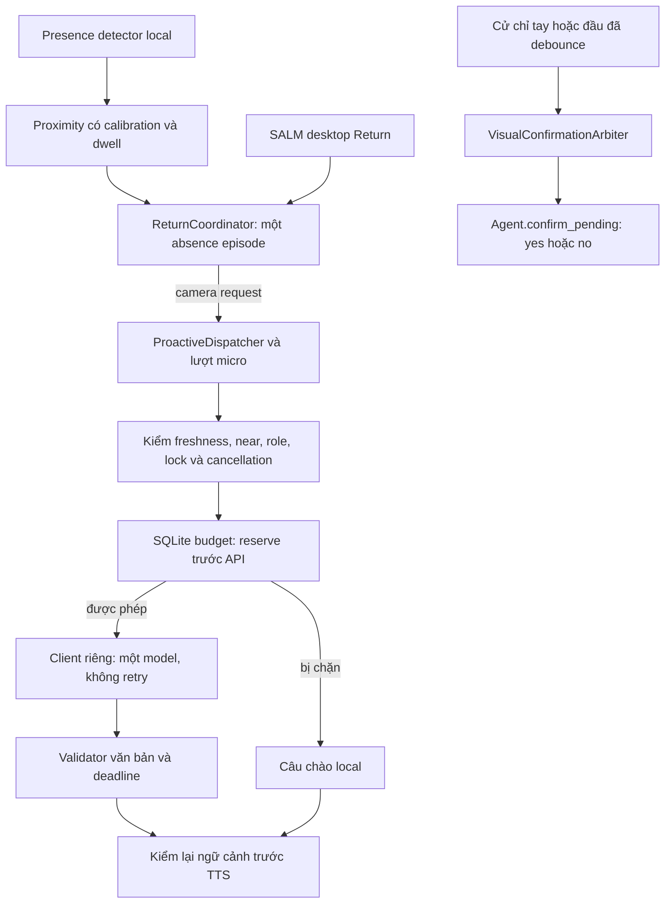

# Tích hợp camera với lời chào LLM và xác nhận của Alice

**Phiên bản:** 1.0 · 2026-09-28
**Trạng thái:** Đã nối trong mã sau khi chủ máy báo thử nghiệm camera ổn và chọn phạm vi “lời chào quay lại + xác nhận bằng cử chỉ”. Phần tích hợp mới chưa chạy thử với webcam/API trong phiên chỉnh sửa này.
**Liên quan:** [Đặc tả](camera_ai_spec.md) · [Kiến trúc](camera_ai_architecture.md) · [Riêng tư](camera_ai_security_privacy.md)

## 1. Phạm vi đã duyệt

- Camera phát hiện một lượt quay lại hợp lệ có thể yêu cầu LLM viết một lời chào ngắn.
- Thumbs-up, OK và gật đầu đồng ý; lắc đầu từ chối một hành động Alice đang chờ xác nhận. Thumbs-up tiếp tục là lời khen, cập nhật mood local như trước.
- Face Auth v1 chỉ gợi ý profile; hồ sơ chủ máy vẫn luôn hoạt động. Emotion chỉ ở debug panel. Các kết quả này không vào prompt và không tạo lượt gọi API.
- Một nguồn webcam local có role `workstation_facing`; chưa có nhiều camera, vision LLM, suy luận tâm lý hoặc cảnh báo bảo mật.

Quyết định này mở thêm chế độ `llm` bên cạnh `off/shadow/local`, thay thế giới hạn local-only của bản camera Return đầu tiên. Mặc định trong mã vẫn là `shadow` và head confirmation tắt; `src/.env` của máy chủ dự án đã được đặt `llm` và bật head confirmation theo yêu cầu này.

## 2. Đường đi



Camera worker chỉ nộp request/callback. SQLite, HTTP, chờ LLM và TTS chạy ngoài capture/presence worker. Camera không thay đổi `SalmEngine.presence`, clock, care hoặc schema presence của IoT.

### Thành phần

| Module | Trách nhiệm |
|---|---|
| `camera/return_coordinator.py` | Episode, hợp nhất desktop/camera, một lần thử chào, kiểm request còn hợp lệ |
| `camera/welcome.py` | Client riêng, payload bounded, tiêu thụ episode, admission trước call, debug |
| `camera/call_budget.py` | Bộ đếm SQLite bền vững, admission nguyên tử qua nhiều thread/process |
| `salm/welcome.py` | Prompt/validator/fallback dùng chung; optional `before_call` và `status_sink` cho camera |
| `camera/visual_confirmation.py` | Pending object và timestamp, cửa sổ xung đột, hủy/pause, chốt một lần |
| `app.py` | Composition, gate, ownership micro/TTS và cấu hình nguồn |

## 3. Điều kiện lời chào

1. Calibration phù hợp source/resolution/detector; một mặt ở vùng `near` đã ổn định trước đó.
2. Sau đó quan sát `far` hoặc `no_face` khỏe đủ tối thiểu 120 giây. `no_face` có recent desktop input không được dùng làm vắng. `unknown`, blur, pause và reconnect không tích lũy thời gian vắng.
3. `near` mới ổn định tạo một `WelcomeRequest`. Cooldown coordinator tối thiểu 300 giây. Camera và desktop được hợp nhất bằng khoảng vắng và thứ tự transition trong cùng process.
4. `WelcomeRequest` giữ `source`, `absence_episode_id`, `absence_seconds`, `observed_monotonic` và `generation` trong RAM. Đây không phải payload gửi tới LLM.
5. Request hết hạn sau 10 giây; nguồn phải vẫn hoạt động, cùng generation, observation mới không quá 2,5 giây, vẫn `near`, SALM snapshot mới không quá 3 giây, session không locked/suspended/display-off. Kiểm trước khi xử lý và trước khi nói.
6. Work mode, meeting và direct reply đang bận chặn qua proactive gate. Khi có micro, lời chào lấy lượt qua `_VoiceTurnCoordinator`; nếu người dùng vừa nói thì nhường. Không tạo API call trước khi được cấp lượt.
7. Nếu thời gian còn lại không đủ deadline LLM, dùng local fallback. Pause/mất nguồn/khóa máy hoặc người đã rời vị trí trước output làm bỏ lời chào.

Mã `return-episode-N` là số thứ tự ứng viên trong phiên coordinator, không phải ID webcam. Candidate log có `camera_id` riêng. `accepted` ở log coordinator nghĩa là đã được đưa tới nhánh thử chào, không phải chứng nhận LLM/TTS thành công. Một episode đã thử được tiêu thụ cả khi dispatcher/gate từ chối; không replay để thử API lần nữa.

## 4. Hạn mức và vòng đời call

### Giới hạn mặc định

| Giới hạn | Giá trị |
|---|---|
| Khoảng cách tối thiểu giữa hai camera LLM attempt | 900 giây |
| Attempt trong cửa sổ trượt 1 giờ | 3 |
| Attempt trong cửa sổ trượt 24 giờ | 12 |
| Camera welcome đang gọi LLM trong một process | 1 |
| Deadline tạo câu chào | 5 giây mặc định, clamp 0,5–10 giây |
| Output token budget | 256 mặc định, clamp 128–512 |
| Kích thước system/user text | 6000 / 500 ký tự |
| Retry hoặc xoay model sau lỗi | 0 |

`CAMERA_WELCOME_LLM_MIN_INTERVAL_SECONDS` chỉ có thể tăng từ 900; hourly/daily caps chỉ có thể giảm từ 3/12. Giá trị cap bằng 0 chặn LLM. Output token limit không phải giới hạn hóa đơn bằng tiền; số token đầu vào, cách tính của provider và những lane khác vẫn có chi phí riêng.

Budget dùng `data/camera-llm-budget.sqlite3` độc lập với kho profile/SALM. Tắt hoặc lỗi kho dữ liệu chính không vô hiệu hóa budget. Nếu budget không mở/ghi được, bị khóa quá lâu, path rỗng hoặc clock lùi, camera dùng fallback và không gọi API.

- `camera_welcome_attempts`: hash khóa phiên + episode, Unix timestamp của lần reserve. Không lưu camera ID, observation, prompt, response hoặc hồ sơ.
- `camera_welcome_clock`: high-water timestamp để phát hiện clock lùi.
- `BEGIN IMMEDIATE` và commit với `synchronous=FULL` hoàn tất trước provider call. Lỗi/timeout/validator từ chối/cancel sau reserve không hoàn quota.
- Attempt quá 24 giờ bị xóa khi đánh giá lần tiếp theo. Budget tồn tại qua restart và clear debug. Xóa/đổi file budget đặt lại lịch sử hạn mức, vì vậy không làm việc đó để xử lý lỗi camera.
- Một race cancellation ngay sau reserve có thể tiêu thụ slot mà chưa gọi HTTP; đây là hành vi bảo thủ.
- Timeout chỉ dùng local fallback một lần; worker trả muộn không phát speech, không retry. Khi worker cũ còn treo, request khác không tạo camera call song song.

Giới hạn này áp dụng cho camera welcome. Startup, desktop Return, Agent conversation, STT/TTS và các tính năng LLM khác giữ chính sách riêng. Một lượt camera/desktop trùng episode được coordinator gộp để tránh hai lời chào. Budget không phải quota chung toàn Alice và không phải bộ đếm tài chính chống can thiệp vào file hoặc đồng hồ hệ điều hành.

### Provider

- Dùng cùng `LLM_PROVIDER` và credentials hiện có, nhưng tạo client riêng cho camera.
- Gemini dùng `CAMERA_WELCOME_LLM_MODEL` hoặc model đầu trong `GEMINI_MODELS`; không dùng `RotatingGeminiClient`. Requests không theo redirect hoặc tự retry.
- Claude dùng model override hoặc `LLM_MODEL`, SDK được đặt `max_retries=0` và timeout riêng. Xem [constructor SDK chính thức](https://github.com/anthropics/anthropic-sdk-python/blob/main/src/anthropic/_client.py).
- Ollama dùng model override hoặc `OLLAMA_MODEL`, một HTTP request và `num_predict` để giới hạn output.
- Thiếu client/credentials/model hoặc lỗi provider làm dùng câu local, không kéo Agent hoặc một model khác vào để thử lại.

## 5. Dữ liệu tới LLM

Chỉ gửi contract viết lời chào, persona hiện có, cách xưng hô đã được kiểm tra, loại lời chào `return` và nhịp diễn đạt. Không gửi lịch sử Agent hoặc yêu cầu chạy tool. Response phải qua `clean_welcome_text`: một/hai câu, dưới 35 từ, tối đa 180 ký tự, đúng xưng hô; tool call và câu không đạt bị bỏ.

Không đưa ảnh, crop, embedding, Face Auth score/danh tính, Emotion, proximity band/kích thước mặt, tọa độ/landmark, camera ID, episode ID, thời gian vắng, gesture label hoặc debug log vào request. Camera không có đường vision LLM trong tích hợp này. Lời chào có thể xuất hiện qua TTS/UI như các lời chào Alice hiện có; mọi chẩn đoán camera/budget chỉ ở debug panel.

## 6. Cử chỉ xác nhận

| Tín hiệu | Tác động |
|---|---|
| OK | `yes` cho pending action |
| Thumbs-up | `yes` cho pending action và lời khen mood local |
| Gật đầu | `yes` cho pending action |
| Lắc đầu | `no` cho pending action |

Gesture không tạo lệnh mới và không gửi câu “đồng ý” qua `Agent.run`. Arbiter gọi `Agent.confirm_pending` đúng như nút/giọng xác nhận. Việc chốt/hủy này không tạo thêm call LLM; tool đã được duyệt có thể thực hiện I/O theo chức năng hiện hữu.

Pending phải tồn tại trước khi bắt đầu pose/motion và vẫn là cùng object tại lúc chốt. Tín hiệu quá 5 giây hoặc khi webcam pause/stop, role khác workstation, app đóng, session locked/suspended/display-off bị bỏ. Khi head confirmation bật, arbiter chờ cửa sổ 0,8 giây; yes/no trái nhau trong cửa sổ bị bỏ cho pending đó. Nếu đang chờ agent lock, candidate vẫn được giữ để nhận conflict trước side effect. Sau khi action được chốt, pending được xóa; tín hiệu lặp không thực hiện lại action.

Gật/lắc cần YuNet landmarks; Haar không cung cấp đường này. Không pending thì gật/lắc/OK không tạo thoại; thumbs-up vẫn có phản ứng mood local theo mapping đã chốt. Face Auth suggestion không phải điều kiện xác thực cho gesture.

## 7. Cấu hình và quan sát

Đã bật trong `src/.env` của máy này:

```dotenv
CAMERA_WORKSTATION_RETURN_MODE=llm
CAMERA_HEAD_CONFIRMATION_ENABLED=true
```

Khởi động lại Alice để nạp cấu hình. Shell env có độ ưu tiên cao hơn `.env`. Đổi Return về `local` để dùng câu chào có sẵn, về `shadow` để chỉ chẩn đoán; đặt head flag `false` để giữ gật/lắc ở debug.

Log cần xem trong CAMERA tab:

- `Workstation return candidate`: episode, nguồn và quyết định coordinator.
- `Camera welcome LLM attempt reserved`: quota đã commit trước call.
- `Camera welcome LLM blocked`: reason `min_interval`, `hourly_limit`, `daily_limit`, `budget_unavailable`, `clock_rollback`, `insufficient_deadline` hoặc `stale_or_cancelled`.
- `Welcome LLM completed`: text qua validator và worker có trả muộn không.
- `Visual confirmation applied` hoặc `Visual confirmation conflict`: quyết định chốt/hủy pending, không phải một API call.

Chủ máy đã báo phần camera thử ổn trước tích hợp này. Không thực hiện automated test, webcam test hoặc call API trả phí trong phiên triển khai này; cần quan sát nhánh lời chào mới và quota sau khi khởi động lại.
